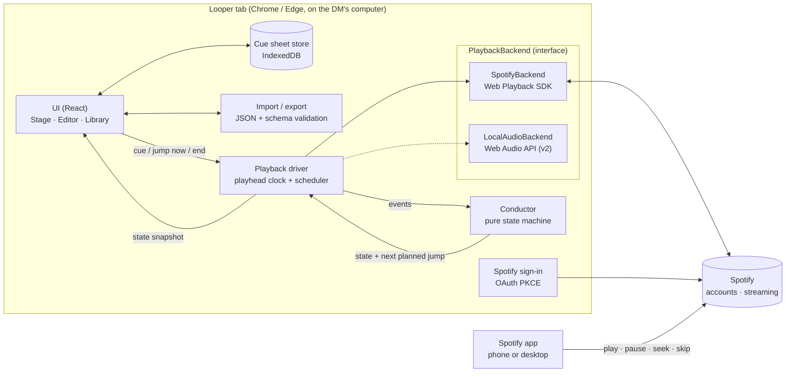
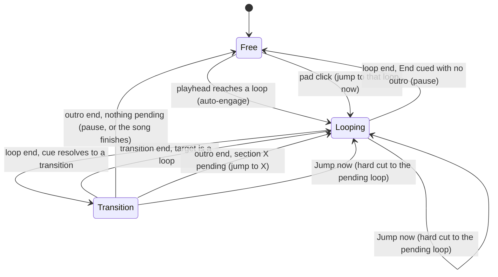
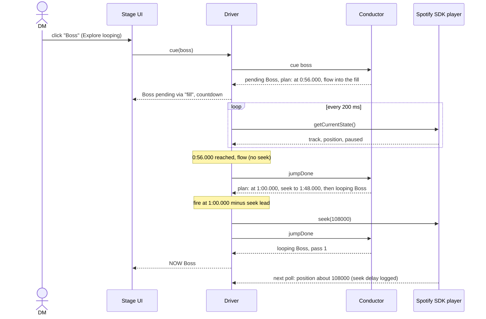

# DM Audio Looper: Technical Design Document

| | |
|---|---|
| **Status** | Draft v0.2, for final review |
| **Date** | 2026-11-27 |
| **Scope** | v1 (Spotify playback, local speakers), plus the path to v2 (local audio files) |

---

## 1. Summary

DM Audio Looper is a browser app that lets a tabletop Game Master play a video-game soundtrack the way a game engine does. You split a track into named **sections**. **Loop** sections (for example *Explore*, *Combat* and *Boss*) repeat until you **cue** another one. **Transition** sections (a drum fill, an outro) play once on the way between them. A cue takes effect at the end of the current loop pass, or immediately with *Jump now*.

v1 plays music through **Spotify**. The looper's browser tab is a Spotify Connect device. You start, pause and skip songs from the **Spotify app** on your phone or computer, as usual. When a song with a **cue sheet** starts playing on the looper, the sheet loads automatically, and looping begins as soon as the song reaches its first loop section. The looper adds only what Spotify can't do: section pads, cues and loop jumps.

Each DM runs **their own copy** of the looper on their own computer, with their own free Spotify developer app (§9.1). Nothing is hosted.

The core logic is kept separate from the audio source, so a **local audio file** backend can be added later. That backend will give seamless, sample-accurate loops, which Spotify cannot.

The main risks are about Spotify, not engineering:
- **Loops can't be seamless.** Every loop is a seek.
- **No beat or bar data.** Spotify no longer gives apps this.
- **Policy risk.** Spotify's [Developer Policy](https://developer.spotify.com/policy/) (Section III.7) bans mixing or overlapping Spotify content, and its [iOS SDK reference](https://developer.spotify.com/documentation/ios/reference) says the platform can't be used for apps that alter Spotify content. Each DM's own developer account carries that risk. See §13.

---

## 2. Background and problem

Video-game music is composed for **adaptive playback**. A game engine loops sections indefinitely and moves between them when gameplay changes (exploration → combat → victory). Official soundtrack releases on streaming services are mixed as **linear songs**: each loop plays once or twice, then the track moves on or fades out.

When a DM plays these tracks during an encounter, the music runs out of the right section or moves into the wrong mood at the wrong time. The DM needs to act as the game engine: decide which section plays, keep it looping, and change it when the story changes.

---

## 3. Requirements captured

### 3.1 Your answers during requirements gathering and review

| Topic | Your answer | Design consequence |
|---|---|---|
| Audio source | Spotify first; local files as a follow-up | Pluggable `PlaybackBackend` (§6). Spotify backend in v1, local backend in v2 (§14) |
| Platform | Web app | A browser app that each DM runs locally. Nothing is hosted (§9.1) |
| How players hear it | Local speakers for v1. Spotify Jam is used today but deferred | The browser tab is the Spotify device. Jam is a future goal (§14.3) |
| Transition timing | Wait for a musical boundary… | …where the boundary is **the end of the current loop pass** (no tempo grid) |
| Controls | On-screen buttons | Section pads, *End* and *Jump now* (§11.3) |
| Play, pause, seek, skip, volume | Keep them in the Spotify app | The Spotify app is the remote control (§8.5). The looper has no transport buttons |
| What a cue can do | Move between sections of one track | The cue is a first-class concept (§7.7) |
| Section types | Loop and transition, both first-class | Every section has a kind, `loop` or `transition` (§7.2) |
| Cueing | One pending cue | Replace or cancel by clicking (§8.2) |
| Transitions tied to | Optional default for every move into a section, overridable per From → To pairing | Nothing plays unless you define it. A specific pairing beats a default (§7.3, §7.4) |
| Transition audio source | Same track | Transition sections are time ranges of the same song |
| Start and stop | Intros play naturally; cued ending | Songs start in the Spotify app, and looping auto-engages at the first loop (§7.8). The ending is a transition to *End* |
| Override | *Jump now* (hard cut), skipping any transition | *Jump now* runs the pending cue immediately (§8.4) |
| Auto-load | Yes, with auto-engage | A song's cue sheet loads when it starts playing on the looper. The first loop section reached starts looping (§7.8) |
| Contiguity | Exact match, with an editor warning | No seek when one section starts exactly where the last ended (§7.5) |
| Authoring | Typed timestamps; JSON import/export | A typed-timestamp editor with preview buttons, and JSON files (§10, §11.4) |
| Distribution | Each DM installs and runs their own copy; not hosted | Each DM uses their own Spotify developer app. Clone and run now; a one-file download later (§9.1, §16) |

### 3.2 Goals

- **G1.** Define loop and transition sections for a Spotify track using typed timestamps, and save them as a **cue sheet**.
- **G2.** During a session, loop the active section indefinitely and switch to the next section at the end of the current loop pass.
- **G3.** Play authored transitions (fill, bridge, outro) between sections when one is defined.
- **G4.** Provide an immediate override (*Jump now*) for dramatic moments.
- **G5.** Keep the core engine independent of the audio source, so local files can replace Spotify without a rewrite.
- **G6.** When a song starts playing on the looper and a cue sheet exists for it, load that sheet automatically.
- **G7.** Let any DM with Spotify Premium set up and run their own copy, with their own Spotify account.

### 3.3 Non-goals (v1)

- Seamless (gapless) loops on Spotify. This is not achievable (§13).
- Crossfades, layering or mixing two audio streams. Spotify's policy forbids it.
- Beat- or bar-quantized switching, or tempo grids.
- Transport controls (play, pause, seek, skip, volume) and choosing songs in the looper. The Spotify app does these (§8.5).
- Cues that switch to another track, playlists and encounter presets. A track change made in the Spotify app does load that track's cue sheet (§7.8).
- Remote players: Spotify Jam, Discord and VTT integration. **Jam is a future goal.** Spike 0 includes a quick test of whether it already works (§14.3).
- Keyboard hotkeys, MIDI, Stream Deck, or a phone remote for the pads.
- Hosting the looper for other people. Each DM runs their own copy (§9.1).

### 3.4 Functional requirements

| ID | Requirement | Priority |
|---|---|---|
| FR-1 | First-run setup: paste your Spotify Client ID, with a setup guide. It's stored locally | Must |
| FR-2 | Sign in with Spotify (Premium) and register the tab as the Spotify Connect device "DM Audio Looper". *Start session* unlocks browser audio | Must |
| FR-3 | Create a cue sheet for the track that is playing on the looper. Its name, artists and duration come from the player | Must |
| FR-4 | Add, rename, reorder and delete sections. Each is a loop or a transition, with a start and end typed as `m:ss.mmm` | Must |
| FR-5 | Define pairings: from a loop (or *Any*) to a loop (or *End*), via a transition section (or *None*) | Must |
| FR-6 | Validate a cue sheet (ranges, kinds, minimum lengths, duplicate pairings, near-miss boundaries) with clear errors and warnings | Must |
| FR-7 | Preview a loop seam or a pairing: play a few seconds before and after the jump | Must |
| FR-8 | Auto-load: when a track starts on the looper, load its cue sheet, matching by track ID including relinked versions. Tracks without a sheet play normally | Must |
| FR-9 | Auto-engage: with a sheet loaded, the first loop section the playhead reaches starts looping | Must |
| FR-10 | Cue: clicking a pad sets, replaces or cancels the single pending cue. In free play it jumps straight to that loop | Must |
| FR-11 | At the end of each loop pass, run the pending cue (through its transition, if any) or loop again | Must |
| FR-12 | *Jump now*: run the pending section cue immediately, with a hard cut that skips any transition | Must |
| FR-13 | *End*: at the end of the current loop pass, play the outro if one is defined, then stop. If the outro reaches the end of the track, let the song finish | Must |
| FR-14 | Show the current section, loop pass, position in the loop, pending cue and time until the switch | Must |
| FR-15 | Store cue sheets locally. Import and export a single sheet or the whole library as JSON | Must |
| FR-16 | A seek-lead setting: one number in milliseconds, defaulting to the value measured in Spike 0 | Should |

### 3.5 Non-functional requirements

| ID | Requirement | Target |
|---|---|---|
| NFR-1 | **Scheduling accuracy:** the app sends each seek command within ±10 ms of its planned time. This excludes Spotify's own seek time | Logged per jump |
| NFR-2 | **Audible seam:** the gap or stutter at a Spotify loop jump | Median ≤ 150 ms, p95 ≤ 300 ms. **Provisional:** validated in Spike 0 (§16); not fully within our control |
| NFR-3 | **Responsiveness:** a click shows as *pending* in the UI within 50 ms. *Jump now* sends its seek within 50 ms | — |
| NFR-4 | **Session reliability:** over a 4-hour session, a missed boundary is recovered automatically within one poll (200 ms) | §9.6 |
| NFR-5 | **Runs locally:** static files served on `127.0.0.1`, with no server-side code and no secrets | — |
| NFR-6 | **Browsers:** the current desktop Chrome and Edge. Firefox is best-effort. Mobile and Safari are out of scope for v1 | — |
| NFR-7 | **Portability:** every cue sheet and setting can be exported as a human-readable JSON file. Credentials are never stored or exported | — |

---

## 4. Glossary

| Term | Meaning |
|---|---|
| **Cue sheet** | All the sections and pairings for one track |
| **Track time** | A position in the song's own timeline, in integer milliseconds from 0:00.000 |
| **Span** | A half-open range of track time, `[startMs, endMs)` |
| **Section** | A named span of the track. It has a kind, `loop` or `transition` |
| **Loop section** | A section that repeats until a cue moves on. Each one is a pad on the Stage |
| **Transition section** | A section that plays **once**, on the way from one loop to another or to *End*, e.g. a fill, bridge or outro |
| **Pairing** | A rule saying which transition (if any) plays when a cue moves from one loop to another, or to *End* |
| **`@end` / *End*** | The target meaning "finish the music". An outro is a transition used for a pairing to `@end` |
| **Cue** | A request to move to a target, either a loop section or *End* (§7.7) |
| **Pending cue** | The cue that will run at the next boundary. There is at most one |
| **Boundary** | The end of the span currently playing: a loop pass or a transition |
| **Free play** | The song is playing but no loop is engaged, e.g. during an intro (§7.8) |
| **Auto-engage** | In free play, the first loop section the playhead reaches starts looping by itself |
| **Seek** | Moving the playhead to a different track time. On Spotify it causes a short audible gap |
| **Contiguous** | The next span starts exactly where the current one ends, so the music just keeps playing, with no seek |
| **Seek lead** | How early (in ms) a seek is sent so that the new audio arrives on time |
| **IndexedDB** | The database built into every browser. Each website gets its own private store of structured records that survives closing the browser (§10.4) |

---

## 5. Spotify platform constraints

These were checked against public sources in November 2026; links are in §18. Spotify has changed these rules three times since late 2024, so treat them as **volatile**.

| Constraint | Effect on this design |
|---|---|
| The **Web Playback SDK** turns a browser tab into a Spotify Connect device. It needs Spotify **Premium** and a browser with DRM (Widevine) support | It is the v1 playback engine. Desktop wrappers (Electron or Tauri) generally lack that DRM support, which is why this is a browser app |
| **Audio Analysis and Audio Features endpoints** (beats, bars, sections, tempo) have been closed to new apps since **27 Nov 2024** (they return 403) | No automatic beat grid or section detection. All loop points come from you |
| **Spotify audio is DRM-protected.** Apps cannot read the decoded audio | No waveform display and no analysis for Spotify tracks. Loop points are set by ear |
| The [**Developer Policy**](https://developer.spotify.com/policy/), **Section III.7**, says: *"Do not permit any device or system to segue, mix, re-mix, or overlap any Spotify Content with any other audio content (including other Spotify Content)."* | No crossfades and no overlapping audio. Every transition is a jump within one audio stream |
| Spotify's [iOS SDK reference](https://developer.spotify.com/documentation/ios/reference) says the platform *"can not be used to develop applications that alter Spotify Content"*. Replies on Spotify's [developer forum](https://community.spotify.com/t5/Spotify-for-Developers/Allowing-users-to-customise-audio-playback/m-p/6459860/highlight/true) say that skipping sections of a track falls under this; that isn't an official ruling | **Policy risk:** looping by seeking may count as altering content. Each DM's own developer account carries this risk, and the app is never hosted for others (§13, R1) |
| **Development Mode limits belong to the app, not to the person signing in.** An app (one Client ID) allows at most **5 allowlisted Spotify accounts**, and its owner must have Premium. Spotify grants more only to [established services](https://developer.spotify.com/blog/2025-04-15-updating-the-criteria-for-web-api-extended-access); third parties report the bar as a registered business with about 250k monthly users | One shared app can't serve many DMs, so **each DM registers their own free app** (§9.1). The looper makes no Web API calls, so API quota isn't a concern (§9.2) |
| **OAuth** (enforced since 27 Nov 2025): public clients must use **Authorization Code with PKCE**, and redirect URIs must be HTTPS or a loopback address. `localhost` is not allowed | Everyone runs the looper locally, so every DM uses the same redirect URI, `http://127.0.0.1:5173/callback` (§9.1) |
| A Premium account streams to **one device at a time** | Your phone or desktop Spotify app acts as the remote control for the looper, rather than playing music itself |
| There is **no Web API access to Spotify Jam** | The app can't start or control a Jam. Whether Jam guests follow the host's loop jumps by themselves is untested (§14.3) |

---

## 6. Architecture overview



| Component | Responsibility | Depends on |
|---|---|---|
| **Conductor** | Holds the musical state (what is playing and what is pending), applies the cueing rules, and computes the **next planned jump**. It has no timers, I/O or framework code, so it can be fully unit-tested | Cue sheet only |
| **Playback driver** | Holds the live session, follows the track playing on the looper, passes cues to the Conductor, estimates the playhead and sends each planned jump at the right moment. Detailed in §6.1 | Conductor, PlaybackBackend, Clock |
| **PlaybackBackend** | A thin wrapper over the audio source: `getState`, `seek`, `pause` and `resume` | Spotify SDK, or Web Audio |
| **Spotify sign-in** | The PKCE flow and token refresh, with tokens in memory only (D18) | Spotify accounts service |
| **Cue sheet store** | Saves and loads cue sheets and settings in IndexedDB | — |
| **Import/export** | Converts between JSON files and cue sheets, and checks them against the schema | — |
| **UI** | The Stage, Editor and Library views (§11) | All of the above |

**Why the Conductor is separate from the driver:** what should happen next is a deterministic music decision, while getting the audio there on time is a messy, platform-specific timing job. Keeping them apart means:

1. The cueing rules can be tested exhaustively with a fake clock.
2. The local-audio backend in v2 can use the same Conductor unchanged, with its own driver that schedules sample-accurately.

### 6.1 Playback driver in depth

The Conductor decides **what** happens next; the driver makes it happen **on time**. The driver is the only component that talks to both the Conductor and the backend, and it holds the live session state that the UI shows.

This is the "functional core, imperative shell" pattern: the Conductor is a pure function, and the driver is the shell around it that holds state, keeps time and performs side effects. In Elm or Redux terms, the Conductor is the reducer and the driver is the effect runner.

#### Responsibilities

| # | Responsibility | Details |
|---|---|---|
| 1 | **Hold the session** | The current track, its cue sheet (if any), the `ConductorState` and the next `PlannedJump`. Nothing else stores them |
| 2 | **Follow the playing track** | When the track changes, it looks up that track's cue sheet and loads it (§7.8). When the position jumps by itself (a seek in the Spotify app), it tells the Conductor where the playhead now is (§8.5) |
| 3 | **Accept cues** | The UI calls `cue(target)` and `jumpNow()`. The driver passes each one to the Conductor and carries out what comes back |
| 4 | **Keep the playhead clock** | Polls the backend every 200 ms and estimates the position in between (§9.3) |
| 5 | **Send jumps on time** | Wakes up just before each boundary and sends the seek or pause. A contiguous boundary sends nothing (§9.4) |
| 6 | **Recover** | Fires late jumps immediately, and stops managing when playback moves elsewhere (§9.6) |
| 7 | **Publish state** | Gives the UI a snapshot and a change notification, read through React's `useSyncExternalStore` |
| 8 | **Log timing** | Writes each jump's measured seek delay and lateness to the browser console, for Spike 0 and for tuning the seek lead |

The driver doesn't apply music rules (the Conductor does), know anything Spotify-specific (SpotifyBackend), save data (cue sheet store) or draw anything (UI).

#### Contract with the Conductor

The Conductor is one pure function. Each event returns the new state and, when there is one, the next planned jump (§8.6):

```ts
type ConductorEvent =
  | { readonly kind: "located"; readonly positionMs: TrackMs }   // a sheet loaded, or the playhead moved by itself
  | { readonly kind: "cue"; readonly target: SectionId | "@end" }
  | { readonly kind: "jumpNow" }
  | { readonly kind: "jumpDone" };                              // the driver has carried out the planned jump

interface ConductorResult {
  readonly state: ConductorState;
  readonly nextJump?: PlannedJump;   // absent when there is nothing to do
}

function conduct(sheet: CueSheet, state: ConductorState, event: ConductorEvent): ConductorResult;
```

#### Dependencies

The driver's constructor takes three dependencies, so tests can pass in fakes:

```ts
interface Clock {
  now(): PerfMs;
  wakeAt(timeMs: PerfMs, callback: () => void): () => void;   // returns a cancel function
}

interface PlaybackBackend {
  getState(): Promise<PlaybackState | null>;   // null: nothing is playing on this device
  seek(positionMs: TrackMs): Promise<void>;
  pause(): Promise<void>;                      // for End
  resume(): Promise<void>;                     // for editor previews
}

interface PlaybackState {
  readonly track: TrackInfo;                   // uri, relinked-from uri, name, artists, duration
  readonly positionMs: TrackMs;
  readonly paused: boolean;
}

type FindCueSheet = (track: TrackInfo) => CueSheet | undefined;   // reads an in-memory copy of the store
```

- **`Clock.wakeAt`** hides how timing is done. The real clock uses a plain `setTimeout` (§9.4). The fake clock runs callbacks when a test advances time.
- **The driver polls `getState()`.** It reads the position every 200 ms on its own clock, so there are no listeners to register. Errors come back as a failed call.
- **`FindCueSheet`** matches by track URI or the relinked-from URI. The store keeps all cue sheets in memory, since they are small, so the lookup is synchronous.

#### One jump, step by step

1. **Plan.** After every Conductor result, the driver cancels any pending wake-up. If there is a `nextJump`, it works out when to act:
   `fireAtMs = now + (nextJump.at − estimatedPosition(now)) − leadMs`, or right away when `at` is `"now"`.
   `leadMs` is the seek lead (§9.5) for a seek, and 0 otherwise.
2. **Wait.** It asks the clock to wake it at `fireAtMs`. Each poll updates the estimate, and the driver repeats step 1.
3. **Act.**
   - On waking, it carries out the jump's action: a seek, a pause, or nothing for a contiguous boundary (the music just keeps playing).
   - It sets a provisional estimate: the new position, playing from the boundary time.
   - It sends `jumpDone` to the Conductor, which returns the next state and plan, so the UI updates straight away and step 1 starts again.
4. **Confirm.** The next poll should show the expected position. The driver logs how long the seek took to land, which is how the seek lead gets tuned (§9.5). If it hasn't landed within 1 s, the driver shows an error (§9.6).

#### Shape of the code

- **One class, `PlaybackDriver`,** in `src/playback/`. It's a stateful adapter with a lifecycle, which is when `CLAUDE.md` allows a class.
- **Public methods:**
  - `cue()` and `jumpNow()`;
  - `preview()` for the editor (§11.4);
  - `subscribe()` and `getSnapshot()` for the UI;
  - `dispose()`, which cancels the poll and any wake-up.

  One driver lives for the whole session, and cue sheets come and go as tracks change.
- **Snapshot for the UI:**
  - the current track and its cue sheet, if any;
  - the Conductor state;
  - the next planned jump, for the countdown;
  - the latest position, so the progress bar can animate itself without re-rendering every frame;
  - a status: `waiting` (nothing is playing on the looper), `playing`, or `error` with a message.
- **Internal state:** the latest poll (the anchor), any seek awaiting confirmation, and the cancel function for the pending wake-up.
- **Tests (§15):** scenario tests with the fake clock and fake backend. For example: "100 loop passes with a seek delay of 120 ± 30 ms: every seek is sent within ±10 ms of plan".

---

## 7. Music model

This section describes the core idea of the app. The central concept is the **cue** (§7.7): everything else describes what a cue can move between and how it gets there.

### 7.1 Concepts

A cue sheet describes **one track** as a set of sections plus pairings:

- **Loop sections** are where the music can rest. Each repeats until a cue moves on, and each is a pad on the Stage.
- **Transition sections** are passages that play once on the way somewhere: a fill into *Combat*, or an outro into silence.
- **Pairings** say which transition, if any, plays when a cue moves from one loop to another loop, or to *End* (`@end`).
- **A cue** is your request to move. It waits for the end of the current loop pass, then plays the pairing's transition (if any) and lands on its target.

```
[Explore] ──(fill)──► [Combat] ◄──────────────► [Boss] ──(outro)──► End
  ⟲ loops               ⟲ loops                  ⟲ loops
```

All positions are **integer milliseconds of track time**. Spans are half-open, `[start, end)`.

### 7.2 Sections

Every section has a **kind**, a name and a span:

- **Loop:** when the playhead reaches the end and nothing is pending, it jumps back to the start, and the pass counter goes up by one.
- **Transition:** it plays once, only as part of a cue. It never appears as a pad.

Rules:
- Sections may overlap or nest. For example, a "Combat (short)" loop can sit inside "Combat (full)". One section's end time can be the next section's start time, which is what lets the music flow on without a seek (§7.5).
- The order of loop sections in the cue sheet is the order of the pads on the Stage.
- One transition section can be used by any number of pairings. The fill in §7.6 is used twice.

### 7.3 Transitions and pairings

**By default nothing plays between sections:** a cue simply jumps from the end of the current loop to the start of its target. To play a transition, you add a pairing:

```ts
interface Pairing {
  readonly from: SectionId | "*";    // a loop section, or "*" for any loop
  readonly to: SectionId | "@end";   // a loop section, or End
  readonly via: SectionId | null;    // a transition section; null means "no transition"
}
```

| What you want | Pairing |
|---|---|
| A fill when moving from *Explore* to *Combat* | `{ from: "explore", to: "combat", via: "fill" }` |
| The same lead-in whenever you move into *Combat*, from any loop | `{ from: "*", to: "combat", via: "fill" }` (an optional default) |
| No lead-in from *Boss* to *Combat*, even though a default exists | `{ from: "boss", to: "combat", via: null }` |
| An outro whenever you press *End* | `{ from: "*", to: "@end", via: "outro" }` |
| A different outro after *Boss* | `{ from: "boss", to: "@end", via: "boss-ending" }` |

`via: null` is only useful to switch a default off for one specific move. Without a default, leaving the pairing out does the same.

### 7.4 Transition resolution

When a cue moves from loop `F` to target `T`:

1. If there is a pairing from `F` to `T`, use its transition. `null` means none.
2. Otherwise, if there is a default pairing (`from: "*"`) to `T`, use its transition.
3. Otherwise, there is no transition: jump straight to `T`.

So a specific pairing always beats a default, and with no pairings at all every cue is a direct jump.

### 7.5 Contiguity: avoiding seeks

Each Spotify seek leaves an audible gap, so the engine **only seeks when the audio is not continuous**. When the next span starts **exactly** where the current span ends, for example a loop ending at 0:56.000 and a fill starting at 0:56.000, the music just keeps playing. The Conductor changes state, and no seek is sent.

Timestamps are typed by hand, so two times meant to be equal can differ by a few milliseconds. **The editor flags near-misses:** two boundaries a cue moves between that are within 20 ms of each other but not equal. For example: "*Fill* starts 10 ms after *Explore* ends. Make them equal?" The engine itself only ever compares exactly.

Soundtrack releases usually keep the game's sections in their original order, so many moves need no seek at all. Only the loop-back itself (end → start) always needs a seek.

### 7.6 Worked example

The track is a fictional *"Example Battle Theme"*, 2:45.000 long:

```
0:00.000  0:08.000                         0:56.000 1:00.000                         1:48.000                         2:36.000  2:45.000
   |-intro-|=========== Explore ============|-fill-|============ Combat ============|============= Boss =============|-outro-|
```

| Section | Kind | Span |
|---|---|---|
| Explore | loop | `0:08.000–0:56.000` |
| Fill | transition | `0:56.000–1:00.000` |
| Combat | loop | `1:00.000–1:48.000` |
| Boss | loop | `1:48.000–2:36.000` |
| Outro | transition | `2:36.000–2:45.000` |

The intro (0:00–0:08) isn't a section: it plays naturally when the song starts (§7.8).

| Pairing | Meaning |
|---|---|
| `* → combat via fill` | A default: any move into *Combat* plays the fill |
| `explore → boss via fill` | The same fill, reused for *Explore* → *Boss* |
| `* → @end via outro` | *End* from any loop plays the outro |

| Move | What plays | Seeks |
|---|---|---|
| Song started in the Spotify app | Free play through the intro; *Explore* auto-engages at 0:08 | **0** |
| *Explore* loops | at 0:56, jump to 0:08 | 1 per pass |
| *Explore* → *Combat* | the end of *Explore* flows into the fill, and the fill flows into *Combat* | **0** |
| *Combat* → *Explore* | no pairing, so at 1:48 jump to 0:08 | 1 |
| *Explore* → *Boss* | *Explore* flows into the fill; at 1:00, jump to 1:48 | 1 |
| *Boss* → *Combat* | the default applies: at 2:36, jump to 0:56; the fill flows into *Combat* | 1 |
| *Boss* → *End* | *Boss* flows into the outro, which reaches the end of the track; the song finishes and Spotify plays what's next in your queue | **0** |
| *Explore* → *End* | at 0:56, jump to 2:36, then the outro plays to the end of the song | 1 |
| *Combat* → *Boss* with *Jump now* | jump to 1:48 immediately | 1 |

### 7.7 Cues

A **cue** is the core action of the app: your request to move the music somewhere else.

- **Target:** a loop section, or *End*.
- **When it runs:** at the end of the current loop pass (the next boundary), or immediately with *Jump now* (§8.4). In free play, a pad click runs at once, because there is no loop to finish.
- **How it runs:** through the transition that §7.4 resolves for that move, if any. Otherwise it jumps directly.
- **Lifecycle:**
  1. **Pending:** shown on its pad with a countdown to the boundary. There is only ever one pending cue, and clicks replace or cancel it (§8.2).
  2. **Running:** its transition is playing.
  3. **Done:** the target loop is playing, or the music has stopped (*End*).
- **Running transitions finish (D11).** A cue made while a transition plays waits for the next boundary, so a transition always reaches the loop it was written for. *Jump now* can still interrupt it.

### 7.8 Auto-load and auto-engage

The looper follows whatever the Spotify app plays on it:

- **Auto-load.** When a new track starts on the looper, the driver looks up its cue sheet by track URI. Spotify sometimes substitutes a regional version of a track, so the lookup also tries the URI that version was relinked from.
  - **Sheet found:** its pads appear.
  - **No sheet:** the song plays normally, and the Stage offers *Create cue sheet for this track*.
- **Locating the playhead.** When a sheet loads, or the playhead moves by itself (§8.5), the Conductor receives the current position:
  - **Inside a loop section:** that loop is engaged straight away. If the position is inside several, the first in pad order wins.
  - **Anywhere else:** the state is **free play**. The song plays normally, and the next loop section ahead of the playhead is planned for auto-engage.
- **Auto-engage.** In free play, when the playhead reaches the start of a loop section, that loop engages, with no seek. A song started from 0:00 therefore plays its intro naturally and settles into its first loop, with no intro configuration.
- **Clicking a pad in free play** jumps straight to that loop's start, at once, with no transition. While playback is paused, pads are disabled with the hint "Press play in your Spotify app".

---

## 8. Playback rules (Conductor)

### 8.1 States



A new track or a seek in the Spotify app re-locates the playhead from any state (§7.8, §8.5).

The Conductor's state is a single record:

```ts
type PlayState =
  | { readonly kind: "free" }
  | { readonly kind: "looping"; readonly section: SectionId; readonly pass: number }
  | { readonly kind: "transition"; readonly from: SectionId; readonly to: SectionId | "@end"; readonly via: SectionId };

interface ConductorState {
  readonly play: PlayState;
  readonly pending: SectionId | "@end" | null;
}
```

### 8.2 Cue rules (clicking a pad or *End*)

**General rule**, while a loop or transition is playing:

- Clicking the **pending** pad cancels the pending cue.
- Clicking the section the music is **in or heading to** (the current loop, or the target of the playing transition) cancels any pending cue. It means "stay here".
- Clicking **any other** pad makes it the pending cue, replacing any other.
- *End* sets a pending *End*. Clicking *End* again cancels it.

**Exceptions:**

| State | Click | Result |
|---|---|---|
| Free play | a pad | Jump straight to that loop now, with no transition (§7.8) |
| Free play | *End* | Nothing (button disabled) |
| Transition into loop T | another pad | Pending. It runs at the end of T's first loop pass (D11) |
| Outro (transition to *End*) | a pad | Pending. When the outro ends, that loop starts instead of the music stopping (D17) |
| Outro (transition to *End*) | *End* | Nothing (button disabled: the music is already ending) |

The time until the switch is always visible as a countdown on the pending pad (§11.3).

### 8.3 Boundaries

A **boundary** is the end of the span currently playing.

- **End of a loop pass in section S:**
  - If a section is pending, resolve the move from S (§7.4). Play its transition if there is one, otherwise jump straight to the target loop. Then clear the pending cue.
  - If *End* is pending, play the outro the same way. With no outro, pause: the music stops at the end of the loop.
  - If nothing is pending, loop again: seek to S's start and add one to the pass count.
- **End of a transition into a loop:** enter that loop.
- **End of an outro:**
  - If a section X is pending, jump to X's start (D17).
  - Otherwise, if the outro reaches the end of the track (its end is within 1 s of the track's duration), do nothing. The song finishes, and Spotify plays whatever is next in your queue.
  - Otherwise, pause.

Every move into a new span is a seek, unless the spans are contiguous (§7.5).

### 8.4 *Jump now* (hard cut)

*Jump now* runs the **pending section cue** immediately. It seeks straight to the target loop's start and **skips any transition**, as you chose. The state becomes looping that section, pass 1.

- The button is enabled only while a section cue is pending, so a hard cut takes two clicks: the destination pad, then *Jump now*.
- It is disabled while *End* is pending. To stop the music instantly, pause in the Spotify app.

A possible later improvement is a one-click shortcut, such as Shift+click or a long-press on a pad.

### 8.5 Pause, seek and skip in the Spotify app

The Spotify app on your phone or computer is the remote control for playback. The looper reacts to it:

- **Pause.** The next poll reports `paused`, so the driver cancels its pending wake-up. The Conductor's state, including any pending cue, is kept. Pads and *Jump now* are disabled until playback resumes, so a cue never seeks into silence.
- **Resume.** The driver plans the next jump again from the new position.
- **Seek.** If a poll's position differs from the driver's estimate by more than 500 ms, and no jump of the looper's own is in progress, the playhead moved by itself. The driver sends `located`, and the Conductor clears any pending cue and re-locates (§7.8).
- **Skip or start another song.** This is a track change, so auto-load runs (§7.8).
- **Volume** is entirely the Spotify app's.

### 8.6 What the Conductor gives the driver

After every event, the Conductor reports the **next planned jump**, if there is one:

```ts
type JumpAction =
  | { readonly kind: "seek"; readonly toMs: TrackMs }
  | { readonly kind: "flow" }      // contiguous: send nothing, the music just keeps playing
  | { readonly kind: "pause" };    // End: stop here

interface PlannedJump {
  readonly at: TrackMs | "now";    // a boundary, or immediately
  readonly action: JumpAction;
  readonly next: PlayState;        // the state once the jump is done
}
```

Starting a loop from free play, and *Jump now*, are planned jumps with `at: "now"`. Auto-engage is a `flow` jump at the loop's start. The driver carries out the plan, then sends the Conductor a `jumpDone` event (§6.1). The Conductor never deals with wall-clock time.

---

## 9. Spotify backend (v1)

### 9.1 Setup and sign-in

**One-time setup, per DM** (about 5 minutes, with a guide in the repository):

1. Create a free app in the [Spotify developer dashboard](https://developer.spotify.com/dashboard), with the Web Playback SDK selected. This needs Spotify Premium, which playback needs anyway.
2. Add `http://127.0.0.1:5173/callback` as its redirect URI. It's the same for every DM, because everyone runs the looper locally.
3. Start the looper. During development that means clone and `npm run dev`; after M4, it's the downloaded launcher (§16). Paste the app's **Client ID** into the setup screen.
   - The Client ID is stored locally in IndexedDB. It isn't a secret.
   - For development, `VITE_SPOTIFY_CLIENT_ID` in `.env.local` can prefill it.

**Why each DM needs their own app:** Development Mode limits belong to the app (its Client ID), not to the person signing in. One shared app would allow only 5 Spotify accounts, and Spotify won't lift that for individuals (§5). With their own app, each DM has their own allowlist and limits.

**Each session:**

1. **Connect Spotify.** This starts the **Authorization Code with PKCE** flow in the browser. No client secret and no backend are needed.
   - **Scopes:** `streaming user-read-email user-read-private`, which the SDK needs. The looper makes no other Spotify API calls.
   - **Tokens (D18):** both the access token and the refresh token are kept **in memory only**. The access token is refreshed automatically before it expires (it lasts an hour). After a page reload you click *Connect* again. If you've approved the app before and are still logged in to Spotify in that browser, Spotify usually sends you straight back.
2. **Create the player.** Load `https://sdk.scdn.co/spotify-player.js` and create a `Spotify.Player` named **"DM Audio Looper"**.
   - On the `ready` event, the tab is a Spotify Connect device.
   - A non-Premium account gets the SDK's `account_error`, which is shown as a clear message.
3. **Start session (D16).** Browsers only let audio start after a click on the page, and the sign-in redirect leaves the page, so the *Connect* click can't unlock audio. The Stage therefore shows one **Start session** button, once per page load. Its click calls `player.activateElement()`.
4. **Pick the device and play.** In your Spotify app, choose **DM Audio Looper** as the device and play a song. From then on the looper follows what plays (§7.8).

### 9.2 Spotify calls

**The looper makes no Web API calls.** It uses only the sign-in flow and the SDK's local player, which also reports the track's name, artists and duration. That avoids network delay on every jump, and API quota is never a concern.

| Purpose | Call | Docs | When |
|---|---|---|---|
| Sign-in | Authorization Code with PKCE (`accounts.spotify.com`) | [PKCE flow](https://developer.spotify.com/documentation/web-api/tutorials/code-pkce-flow) | On *Connect*, plus token refreshes |
| Create the player | SDK: `new Spotify.Player(...)`, `connect()`, the `ready` and `account_error` events | [Web Playback SDK reference](https://developer.spotify.com/documentation/web-playback-sdk/reference) | On page load |
| Unlock audio | SDK: `player.activateElement()` | [Web Playback SDK reference](https://developer.spotify.com/documentation/web-playback-sdk/reference) | On *Start session* |
| Playback state | SDK: `getCurrentState()` (track, position, paused) | [Web Playback SDK reference](https://developer.spotify.com/documentation/web-playback-sdk/reference) | Polled every 200 ms |
| Jumps | SDK: `player.seek(ms)` | [Web Playback SDK reference](https://developer.spotify.com/documentation/web-playback-sdk/reference) | At boundaries, and on *Jump now* |
| Stop at *End* | SDK: `player.pause()` | [Web Playback SDK reference](https://developer.spotify.com/documentation/web-playback-sdk/reference) | When an outro or *End* finishes (§8.3) |
| Editor previews | SDK: `player.resume()` | [Web Playback SDK reference](https://developer.spotify.com/documentation/web-playback-sdk/reference) | When a preview starts while paused |

### 9.3 Playhead clock

The SDK gives position snapshots but not a running clock. The driver polls `getState()` every 200 ms, keeps the latest result as an **anchor**, and extrapolates from it:

```
anchor = { positionMs, perfMs: performance.now() when the poll returned, paused }
estimate(t) = paused ? anchor.positionMs : anchor.positionMs + (t − anchor.perfMs)
```

- **No filtering:** every poll replaces the anchor. Polls scatter by a few milliseconds, which is negligible next to the seek gap. Spike 0 measures the scatter (§16), and smoothing is added only if it turns out to cause audible problems.
- **Track check:** a poll with a different track URI is a track change, so auto-load runs (§7.8). A `null` state means nothing is playing on the looper (§9.6).
- **Position check:** a poll more than 500 ms away from the estimate, with no jump of the looper's own in progress, means the playhead moved by itself (§8.5).

### 9.4 Scheduling a jump

For each `PlannedJump`:

```
fireAt (wall clock) = now + (plan.at − estimate(now)) − seekLeadMs     // seekLeadMs only for a seek
```

- **Timer:** a plain `setTimeout` through `Clock.wakeAt`. If Spike 0 shows late jumps, the clock can add a tight final loop for the last few milliseconds without the driver changing.
- **Background tabs:** Chrome exempts **audible** tabs from background timer throttling, and while the looper plays, its tab is audible.
- **Replanning:** every poll restarts the countdown from the latest estimate. So do cue changes, pauses and resumes.
- **Late:** if `fireAt` has already passed (for example, the laptop was busy), the jump fires immediately and the delay is logged.

This is the *Explore → Boss* move from §7.6. Explore's end flows into the fill with no seek, and one seek happens at the end of the fill:



### 9.5 Seek lead

`player.seek()` returns before the new audio is audible, so a jump would land late unless it is sent early by the expected delay.

- **One setting, `seekLeadMs`,** defaulting to the delay measured in Spike 0, and limited to 0–700 ms. The 1 s minimum transition length (§10.3) depends on this limit.
- **Tuning:** the driver logs each seek's measured delay (§6.1), and you adjust the setting by ear with the editor's seam preview. Speaker latency (for example, Bluetooth) delays the old and new audio equally, so it does **not** need compensation.
- **Trade-off:** sending early cuts the last few milliseconds of the loop instead of making the next loop start late, which keeps it on the beat.
- **Later:** automatic measurement is added only if one fixed number turns out not to be good enough.

**Authoring tip (for the editor's help text):** loops sound best when the end point sits on a sustained note or a beat where a short gap is hard to notice.

### 9.6 Failures and recovery

| Situation | Detection | Response |
|---|---|---|
| A jump is late, or a boundary was missed (the laptop was busy) | The planned time has already passed | Jump immediately and log the delay |
| Playback moved elsewhere: another device, or nothing is playing | `getState()` returns `null` | Stop managing. The Stage shows "In your Spotify app, choose DM Audio Looper as the device" |
| Anything else: a seek that hasn't landed after 1 s, or SDK, sign-in or network errors | A failed call or an unexpected state | An error banner with the message. An expired token is first refreshed silently |

---

## 10. Data model and persistence

### 10.1 Types

```ts
// Branded types: plain numbers and strings at runtime, but the compiler keeps them apart.
type TrackMs   = number & { readonly __brand: "TrackMs" };   // integer ms of track time
type PerfMs    = number & { readonly __brand: "PerfMs" };    // wall-clock ms (performance.now())
type SectionId = string & { readonly __brand: "SectionId" }; // matches ^[a-z0-9][a-z0-9-]*$

interface Span { readonly startMs: TrackMs; readonly endMs: TrackMs }   // [start, end)

interface CueSheet {
  readonly schema: "dmaudiolooper/cuesheet";
  readonly schemaVersion: 1;
  readonly id: string;                             // UUID
  readonly title: string;                          // display name, which you can edit
  readonly source: SpotifySource;                  // v2 adds LocalSource
  readonly sections: readonly Section[];           // loop order = pad order on the Stage
  readonly pairings: readonly Pairing[];
  readonly notes?: string;
  readonly createdAt: string;                      // ISO 8601
  readonly updatedAt: string;
}

interface SpotifySource {
  readonly kind: "spotify";
  readonly trackUri: string;                       // spotify:track:<id>
  readonly trackName: string;
  readonly artists: readonly string[];
  readonly durationMs: TrackMs;
}

interface Section {
  readonly kind: "loop" | "transition";
  readonly id: SectionId;                          // generated from the name, e.g. "boss-fight"; stable across renames
  readonly name: string;
  readonly span: Span;
}

interface Pairing {
  readonly from: SectionId | "*";                  // a loop section, or any loop
  readonly to: SectionId | "@end";                 // a loop section, or End
  readonly via: SectionId | null;                  // a transition section, or none
}
```

- **Plain data in files:** files store plain numbers and strings. The import check (§10.4) converts them into these types as they enter the app.
- **No clashes:** section IDs can't contain `*` or `@`, so they never clash with the reserved names.
- **One version for now:** `schemaVersion` is kept so that a future version can be recognised. Migration code is written only when a second version exists.

### 10.2 Example file

This is the worked example from §7.6:

```json
{
  "schema": "dmaudiolooper/cuesheet",
  "schemaVersion": 1,
  "id": "7f1c2a9e-3b4d-4e8f-9a01-2c3d4e5f6a7b",
  "title": "Example Battle Theme",
  "source": {
    "kind": "spotify",
    "trackUri": "spotify:track:0000000000000000000000",
    "trackName": "Example Battle Theme",
    "artists": ["Example Composer"],
    "durationMs": 165000
  },
  "sections": [
    { "kind": "loop",       "id": "explore", "name": "Explore", "span": { "startMs": 8000,   "endMs": 56000 } },
    { "kind": "transition", "id": "fill",    "name": "Fill",    "span": { "startMs": 56000,  "endMs": 60000 } },
    { "kind": "loop",       "id": "combat",  "name": "Combat",  "span": { "startMs": 60000,  "endMs": 108000 } },
    { "kind": "loop",       "id": "boss",    "name": "Boss",    "span": { "startMs": 108000, "endMs": 156000 } },
    { "kind": "transition", "id": "outro",   "name": "Outro",   "span": { "startMs": 156000, "endMs": 165000 } }
  ],
  "pairings": [
    { "from": "*",       "to": "combat", "via": "fill" },
    { "from": "explore", "to": "boss",   "via": "fill" },
    { "from": "*",       "to": "@end",   "via": "outro" }
  ],
  "createdAt": "2026-11-02T18:00:00Z",
  "updatedAt": "2026-11-02T18:00:00Z"
}
```

A library export wraps these as `{ "schema": "dmaudiolooper/library", "schemaVersion": 1, "cueSheets": [ ... ] }`.

### 10.3 Validation

Errors block saving. Warnings are shown but allowed.

| Check | Severity |
|---|---|
| A span is not `0 ≤ startMs < endMs ≤ durationMs` | Error |
| A loop section is shorter than 1 s | Error |
| A loop section is shorter than 5 s (seek gaps become very noticeable) | Warning |
| A transition section is shorter than 1 s (the seek after it may need to go out up to 700 ms early, §9.5) | Error |
| A section ID doesn't match `^[a-z0-9][a-z0-9-]*$`, or two sections share an ID | Error |
| A pairing's `from` isn't a loop section or `*`; its `to` isn't a loop section or `@end`; its `via` isn't a transition section or `null` | Error |
| Two pairings have the same `from` and `to` | Error |
| A pairing has `via: null` but doesn't override a default (`from: "*"`) for the same target, so it has no effect | Warning |
| A pairing has `from` equal to `to` | Error |
| Two boundaries a cue moves between are within 20 ms of each other but not equal (§7.5) | Warning, with a "make equal" fix |
| A loop ends within 250 ms of the track's end (the track may end before the seek) | Warning |
| Two sections share a name | Warning |
| Sections overlap | Allowed (no message) |

### 10.4 Storage and import/export

- **What IndexedDB is:**
  - The browser's built-in database: think of an embedded document store with keys, indexes and transactions, similar in spirit to LiteDB or SQLite.
  - Each website gets its own private database. It stays on that computer, in that browser profile, and isn't synced anywhere.
  - It holds structured objects directly, with no serialisation needed, and allows hundreds of megabytes.
  - Its native API is asynchronous and callback-based. The small `idb` library wraps it in promises.
  - `localStorage`, the simpler alternative, is synchronous, holds only strings, is limited to about 5 MB, and can't hold the file handles v2 needs.
  - A browser can delete a site's data when the disk is nearly full. Exports are the backup.
- **Storage:** IndexedDB, through the `idb` wrapper. It holds the cue sheets and the settings (Client ID, seek lead). No credentials are ever stored (D18), so exports can't contain any.
- **Export:** one sheet or the whole library, as `.json` files.
- **Import:**
  - Files are checked against the schema with `zod`.
  - When a sheet with the same `id` already exists, the app asks "Replace existing sheet?".
  - Imported text (titles, names, notes) is only ever displayed as plain text, never as HTML.
- **Sharing with other DMs:** JSON files contain only timestamps and track IDs, never audio, so they can be shared freely. The recipient needs Premium and access to the same track.
- **No cloud sync** in v1. To move between computers, export and import.

---

## 11. User interface

The UI is built for a laptop screen and mouse use at the table. Playback itself is controlled from the Spotify app (§8.5).

### 11.1 Setup and connection

- **First run:** a setup screen asks for your Client ID and links to the setup guide (§9.1).
- **Each session:** *Connect Spotify*, then *Start session*, then a hint: "In your Spotify app, choose **DM Audio Looper** as the device and play a song".

### 11.2 Library

A list of cue sheets with **Edit**, **Delete** and **Export** on each, plus **Import** and **Export all**. Sheets are never "opened" for play: the Stage always follows the song playing on the looper.

### 11.3 Stage (used during play)

```
┌ ♪ Example Battle Theme · Example Composer ──────────────── [Library] [Edit] ┐
│ NOW   Explore · pass 3 · 0:41 / 0:48   ▓▓▓▓▓▓▓▓▓▓▓▓▓▓▓▓▓▓▓▓░░░░░            │
│ NEXT  Combat via "Fill" · in 0:07                         [ ⚡ Jump now ]   │
├─────────────────────────────────────────────────────────────────────────────┤
│  ┌─────────────┐   ┌─────────────┐   ┌─────────────┐                        │
│  │  Explore    │   │  Combat     │   │  Boss       │                        │
│  │  ▶ playing  │   │  ◷ 0:07     │   │             │                        │
│  └─────────────┘   └─────────────┘   └─────────────┘                        │
│  [ ■ End (Outro) ]                                                          │
└─────────────────────────────────────────────────────────────────────────────┘
```

- **The Stage follows the playing track:**
  - with a cue sheet: its pads;
  - without one: *Create cue sheet for this track*;
  - with nothing playing on the looper: the device hint (§11.1).
- **In free play**, the NOW line reads, for example, "Free play · Explore starts at 0:08".
- **Pads** are large buttons. The playing pad shows a progress bar. The pending pad pulses and counts down to the switch.
- ***Jump now*** is enabled only while a section cue is pending. Its label names the target, e.g. "Jump to Combat".

### 11.4 Editor

```
┌ Example Battle Theme · Example Composer · 2:45.000 ─────────────────────────────┐
│ SECTIONS                                                                         │
│  ≡  Name      Kind         Start       End         Length   Preview              │
│  ≡  Explore   Loop         0:08.000    0:56.000    48.0 s   [▶ seam]             │
│  ≡  Fill      Transition   0:56.000    1:00.000     4.0 s                        │
│  ≡  Combat    Loop         1:00.000    1:48.000    48.0 s   [▶ seam]             │
│  ≡  Boss      Loop         1:48.000    2:36.000    48.0 s   [▶ seam]             │
│  ≡  Outro     Transition   2:36.000    2:45.000     9.0 s      [+ Add section]   │
│                                                                                  │
│ PAIRINGS                                                                         │
│  From      To        Via        Preview                                          │
│  Any       Combat    Fill       [▶]                                              │
│  Explore   Boss      Fill       [▶]                                              │
│  Any       End       Outro      [▶]                          [+ Add pairing]     │
│                                                                                  │
│ ⚠ None                                                               [Validate]  │
└──────────────────────────────────────────────────────────────────────────────────┘
```

- **New sheets** are created for the track playing on the looper, which supplies its name, artists and duration (FR-3).
- **Timestamp fields** accept `m:ss.mmm`, `ss.mmm` or raw milliseconds, and paste-friendly forms such as `1:12.4`.
- **▶ seam** seeks to 4 s before a loop's end, with that loop engaged, so you hear the jump back exactly as it will happen on the Stage.
- **▶ (pairing)** seeks to 3 s before the *from* loop's end with the cue already pending, so you hear the transition and the landing.
- **Previews need the track playing on the looper.** Otherwise the buttons are disabled with a hint. Previews resume playback if it's paused.

---

## 12. Key decisions

| ID | Decision | Alternatives considered | Rationale | Decided by |
|---|---|---|---|---|
| D1 | **Browser app, run locally by each DM** | Desktop (Electron/Tauri), VTT module, Discord bot, hosted web app | The Spotify Web Playback SDK needs a browser with DRM support. Running locally means nothing to host, and leads naturally to Web Audio for local files | You |
| D2 | **The browser tab is the Spotify device** (Web Playback SDK) | Remote-controlling the Spotify desktop or phone app through the Connect Web API | Seeks and position reads stay local: no network round trip per loop and no API quota spent | Recommended; you agreed |
| D3 | **No backend**; OAuth PKCE in the browser | A small token server | Spotify requires PKCE for public clients. There are no secrets to protect and nothing to host | Proposed |
| D4 | **Conductor kept separate from the driver and backend** | One player class | Deterministic, testable rules; local audio in v2 reuses the Conductor unchanged | Proposed |
| D5 | **Boundary = end of the current span** | Tempo grid; hand-placed exit points | Your choice. It needs no beat data (Spotify no longer provides any) and is the simplest to author. Waiting is limited by *Jump now* | You |
| D6 | **One pending cue**, with replace and cancel | A FIFO queue | Your choice. It fits improvised play and the Stage stays readable | You |
| D7 | **Two section kinds (loop, transition); pairings choose the transition**, resolved pairing → default (`*`) → none. *End* is the `@end` target | Transitions embedded in rules; pairs only, with no defaults | Your choices. A transition is defined once and reused; nothing plays unless you define it | You |
| D8 | ***Jump now* = immediate hard cut that skips transitions**; disabled while *End* is pending | Fade then jump; playing the transition immediately; *Jump now* as "stop now" | Your choice. Stopping instantly is the Spotify app's pause | You |
| D9 | **Seek only when the audio is discontinuous**, compared **exactly**, with editor warnings for near-misses | Always seek; a 20 ms engine tolerance | Each Spotify seek is an audible gap. Exact comparison keeps the engine simple and moves the fuzziness to authoring, where you can see it | You |
| D10 | **Send seeks early by one configurable lead**, defaulting to Spike 0's measurement | Seek exactly at the boundary; an automatically measured lead | Keeps the next loop on the beat with one number. Automatic measurement is added only if needed | You |
| D11 | **Transitions run to completion**; cues made during one wait for the next boundary | Cut transitions short | A transition is written for its target, so cutting it usually sounds wrong. *Jump now* is still available | Proposed, needs review |
| D12 | **IndexedDB + JSON import/export**; no cloud; no migration code until a second schema version exists | localStorage; a cloud database | Portable and private. IndexedDB can also hold v2 file handles | Proposed |
| D13 | **Never overlap, mix, process, record or cache Spotify audio** | Crossfades | Spotify Developer Policy III.7 and the DRM | Required |
| D14 | **Stack: TypeScript, React and Vite; Vitest; Playwright**; `idb`; `zod` | Svelte, Solid, Vue, plain TypeScript or Lit, Angular, non-JavaScript stacks; plain JavaScript; Next.js | TypeScript protects the risky timing and state code. React has the largest ecosystem for a form-heavy editor. The engine doesn't depend on any framework, so this choice is reversible. See §12.1 | Proposed |
| D15 | **Positions in integer milliseconds of track time** | Seconds as floating point; samples | Easy to read in JSON and editors, with no floating-point drift. v2 converts to samples internally | Proposed |
| D16 | **A *Start session* button unlocks audio after sign-in** | Unlock on the *Connect* click (impossible: the sign-in redirect loses the click); unlock on the first pad click | One extra click per session | You |
| D17 | **Clicking a pad during the outro queues a restart:** when the outro ends, that loop starts instead of the music stopping | Disable pads during the outro; cancel the ending and jump straight away | Your choice. It's an ordinary planned jump | You |
| D18 | **Spotify tokens are kept in memory only** | Store the refresh token in IndexedDB to stay signed in across reloads | Nothing is stored, so no credential can leak through an export or be read later by injected script. The cost is one *Connect* click after each page reload | You |
| D19 | **The Spotify app is the remote control:** it starts, pauses, seeks, skips and sets the volume. The looper adds only pads, cues and jumps, and makes no Web API calls | Transport buttons, track search and Web API playback in the looper | Your choice. It removes the Web API calls, preloading, search and transport UI, and DMs keep the Spotify app they know | You |
| D20 | **Auto-load cue sheets on track change; auto-engage the first loop reached** | Choose sheets in a library; free play until a pad is clicked | Your choice. Songs play their intros naturally, so no intro configuration is needed | You |
| D21 | **Each DM runs their own copy with their own Spotify developer app.** Clone and run during development; a one-file download per OS after M3 | One shared app (capped at 5 accounts); a hosted site; an `npx` package | Your choice. It's the only way past the 5-account limit, and matches "install it yourself, not hosted" | You |
| D22 | **The driver polls the backend (`getState`), and the Conductor returns one `PlannedJump` type** that can also mean "now" | Push listeners; a separate immediate-action type | Your choices. One method instead of listener plumbing, and one code path for every jump | You |

### 12.1 Technology stack rationale (D14)

**What the stack has to handle.** This is a small app: a few views and about 20 components. The hard part, the timing engine (Conductor, driver and backends), is plain TypeScript with no UI framework (D4). So the UI framework **does not affect loop timing**. It affects how quickly the form-heavy editor can be built, how much existing help is available, and how easily the app can be changed later.

The two browser APIs that matter most, the Spotify Web Playback SDK and the Web Audio API, are JavaScript APIs. Any stack that reaches them from another language adds a translation layer exactly where timing matters.

#### Language: TypeScript rather than JavaScript

TypeScript's benefits fall on the riskiest parts of this project:

| Benefit | Where it matters here |
|---|---|
| **Unit safety** | Track time (`TrackMs`) and wall-clock time (`PerfMs`) are both just numbers in milliseconds. Mixing them up is the most likely bug in the driver (§9.3–9.4). "Branded" number types turn that mistake into a compile error |
| **Every state handled** | `PlayState` (§8.1) and `JumpAction` (§8.6) are sets of tagged variants, so the compiler checks that every `switch` handles every case. When v2 adds one, every place that ignores it is flagged |
| **One schema for two jobs** | The `zod` schema checks imported JSON and also produces the TypeScript types (`z.infer`), so the validation and the in-memory model can't drift apart (§10.4) |
| **Backend contract** | A new `LocalAudioBackend` must implement `PlaybackBackend`, and the compiler lists anything missing |
| **Spotify SDK types** | Type definitions for the SDK exist (`@types/spotify-web-playback-sdk`) |

The costs are a build step, which Vite handles, and some type annotations. Plain JavaScript with JSDoc type comments gets some of this checking, but with clumsier syntax and weaker editor support for tagged variants. It was rejected because the benefits are concentrated in the timing and state code.

#### UI framework

| Option | Strengths for this app | Main drawback | Verdict |
|---|---|---|---|
| **React** | The largest ecosystem: drag-to-reorder lists (dnd-kit), accessible forms and dialogs (React Aria, Radix), and Testing Library. Most published Spotify SDK examples use it. Developers and AI coding assistants know it best | Re-renders whole components when state changes, so the live progress bar needs care (see below). About 45 KB gzipped | **Chosen** |
| **Svelte 5** | Updates only what changed, which suits the live Stage. Less code, smaller bundles, built-in animations | Smaller ecosystem. Svelte 5 changed the syntax ("runes"), so many tutorials, examples and AI suggestions use the old style | Strong runner-up |
| **SolidJS** | React-like syntax that also updates only what changed; very fast | The smallest community here, with few ready-made components | Viable |
| **Vue 3** | Mature, good documentation, efficient updates, convenient form binding | No clear advantage over React for this app, and a smaller ecosystem for the libraries above | Viable |
| **Plain TypeScript / Lit web components** | No framework dependency | The editor has dozens of validated timestamp fields and rows that can be added and removed. Keeping that page in sync with the data by hand is where time and bugs go | Rejected |
| **Angular** | A complete, opinionated framework | Far heavier than a small personal app needs | Rejected |
| **Non-JavaScript (Flutter web, Rust/WASM, Blazor, Elm)** | — | Every call to the Spotify SDK and Web Audio goes through a translation layer, adding friction in the timing code | Rejected |

**Why React's main weakness doesn't matter here:**
- **The music state changes rarely**, only a few times a minute (cues and boundaries), and React only re-renders then.
- **The fast-moving displays bypass React's state.** The progress bar and countdown use a CSS animation, or a small `requestAnimationFrame` loop that writes to the page element directly. They don't trigger re-renders every frame.
- **Re-renders are targeted.** The UI subscribes to the driver through `useSyncExternalStore` with selectors, so a pad re-renders only when its own status changes.
- **Rendering is fast.** A UI this size typically renders in a few milliseconds, within NFR-1's ±10 ms budget. The jump logs from Spike 0 and M1 will confirm it.

#### Build tool: Vite

- It serves the development build on `http://127.0.0.1`, which matters because Spotify no longer allows `localhost` redirect URIs (§5).
- It outputs plain static files, which the M4 launcher serves locally (§16). No server code is involved (D3).
- It supports TypeScript without extra setup, and Vitest reuses its configuration.

Alternatives: Next.js and Remix are built around server features this app doesn't use. Create React App was deprecated in 2025. A hand-configured webpack setup means more configuration and slower builds.

#### The choice can be reversed

The Conductor, driver, backends, schema and storage are all plain TypeScript, so changing UI framework later only means rewriting the views. **If you already know Svelte or Vue well, that familiarity outweighs the differences above, and that framework should be used instead.**

---

## 13. Limitations and risks

| ID | Limitation or risk | Impact | Likelihood | Mitigation |
|---|---|---|---|---|
| **R1** | **Spotify policy:** looping or skipping parts of a track may count as "altering Spotify Content", even with no overlap or mixing. Spotify could disable a DM's developer app. *(This is a reading of public terms, not legal advice.)* | High: the Spotify path stops working for that DM | Medium | Each DM uses their own developer app, and the setup guide states the risk plainly. The looper is never hosted for others. It never overlaps or processes audio (D13). **The local-file backend is the long-term hedge**, and the architecture keeps it cheap (§14) |
| R2 | **Loops are not seamless on Spotify.** Every non-contiguous jump has an audible gap or stutter, and its length isn't under our control | Medium: less immersive than in-game | Certain | Seek lead (D10), contiguity (D9), authoring tips, and Spike 0's go/no-go (§16). Local files fix this |
| R3 | **No beat grid or waveform:** Audio Analysis is closed and the audio is DRM-protected, so loop points are found by ear | Authoring takes longer | Certain | Typed timestamps, seam previews, near-miss warnings, and shareable JSON (pull timestamps from wikis or other DMs). Waveforms arrive with local files |
| R4 | **Waiting for the end of the loop** can take as long as one full loop pass (minutes for long loops) | Slow reactions | Certain | *Jump now*. Authors can define shorter sub-loops (overlapping sections are allowed). Beat-level boundaries are planned for v2 |
| R5 | **Development Mode rules change.** They changed three times between 2024 and 2026 | Medium: future changes could break setup or sign-in | Medium | The looper makes no Web API calls (§9.2), and the backend sits behind an interface |
| R6 | **Setup friction:** each DM must create a Spotify developer app | Some DMs give up | Medium | A step-by-step guide (§9.1). Spike 0 tests the embed player, which would need no developer app (§17) |
| R7 | **Re-linked or remastered tracks:** the same song can have different track IDs or slightly different timing by region or edition | A sheet doesn't load, or its loop points drift | Low | Match on the relinked-from URI too (§7.8). Sheets are shareable, so a sheet for another version can be imported |
| R8 | **Browser dependence:** desktop Chrome/Edge only, the tab must stay open, and audio needs a click to start | Low | — | A *Start session* button (D16), and a warning when the tab closes |
| R9 | **Needs internet at the table** | Medium if the venue's Wi-Fi is poor | Low–Medium | Spotify buffers ahead, so the current track keeps looping during short drops. Local files work fully offline |
| R10 | **No Jam or remote players in v1** | Online groups and hybrid tables aren't served | Certain | §14.3 describes possible paths |
| R11 | **Scheduling in the browser** (timer delays, garbage-collection pauses) | Occasional late jumps | Low | The audible-tab exemption, late jumps firing immediately, and a tighter timer if Spike 0 shows it's needed (§9.4) |
| R12 | **Conflicting control:** a seek in the Spotify app can arrive just as the looper jumps | A jump lands in an unexpected place | Low | Re-locating on any unexpected position (§8.5) puts the Conductor back in step on the next poll |

---

## 14. Future roadmap

### 14.1 v2: local audio files

The Conductor, the data model and the UI stay the same. Only a new backend and driver are added.

| Area | Approach |
|---|---|
| Playback | **Web Audio API:** decode to an `AudioBuffer` and play spans with `AudioBufferSourceNode.start(when, offset, duration)` on the audio clock, using a look-ahead scheduler (about 100 ms ahead). Seams are **sample-accurate and gapless** |
| Click-free seams | Short 5–10 ms equal-power crossfades at each jump, which is allowed for your own files |
| Driver | Schedules the planned jump in advance instead of seeking on a timer |
| Files and transport | The File System Access API (handles stored in IndexedDB), with drag-and-drop as a fallback. Local files have no Spotify app, so v2 needs its own play and pause buttons. A 5-minute stereo track uses about 100 MB of decoded memory, which is acceptable on a laptop |
| Authoring | Waveform view, snapping to zero crossings, and import of `LOOPSTART`/`LOOPLENGTH` tags (common in game rips) and WAV `smpl` loop chunks |
| Moving sheets across | `source.kind = "local"` plus an `offsetMs` to line up a Spotify cue sheet with a local file of the same recording |
| Musical boundaries | With the audio available, a tempo grid (tap tempo or beat detection) allows switching **on the next bar or phrase** instead of only at the end of the loop |

### 14.2 Later features (in no particular order)

- **Cut from v1 for simplicity:**
  - an always-on-top mini Stage (Document Picture-in-Picture);
  - "set from playhead" and nudge buttons in the editor;
  - section colours;
  - a screen wake lock;
  - a timing debug panel;
  - automatic seek-lead measurement.
- **More ways to trigger:** keyboard hotkeys, MIDI (Web MIDI), a Stream Deck (through keyboard shortcuts), or a phone remote.
- **Multiple tracks:** cues that switch tracks, and scene or encounter presets.
- **A VTT bridge:** a Foundry module that sends combat or scene events to the looper, or that plays local-file loops through Foundry's synced audio.

### 14.3 Remote players and Jam

| Option | Notes |
|---|---|
| **Jam already works** | Possible, untested: if Jam guests follow the host's seeks, loops reach them with no extra work, though each guest may hear jumps at slightly different times. Spike 0 tests it |
| Spotify adds a Jam API | Not available today. It would need to be re-evaluated |
| **Follower mode:** each remote player runs the looper with their own Premium login, and the DM's looper sends its jumps over a relay | All of R1 still applies, and the timing between listeners would only be approximate |
| Local files plus a Discord bot or VTT audio | The cleanest route for online groups. It isn't possible with Spotify audio |

---

## 15. Testing strategy

| Layer | Approach |
|---|---|
| **Conductor** | Table-driven unit tests (Vitest) covering every rule in §8.2 and §8.3, every resolution case in §7.4, contiguity, and locating and auto-engage (§7.8), built on the §7.6 example. Property-based tests are added only if the tables leave gaps |
| **Driver** | Tests with a **fake clock and a fake backend** that has a configurable seek delay, jitter and position noise. They check that the fire time equals boundary minus lead, that polls replan, and that late jumps, re-locating after an outside seek, track changes and "nothing playing" are handled |
| **Validation and import** | Schema tests with good and bad fixtures, including near-miss warnings |
| **UI end-to-end** | Playwright, with the app running on the fake backend through a `?backend=fake` dev flag. These tests cover creating a sheet, auto-load, cueing, *Jump now*, *End*, and import/export |
| **Spotify integration** | **Manual only.** DRM and real logins can't run in CI. There's a manual test script plus the Spike 0 measurement page |

---

## 16. Delivery plan

| Milestone | Contents | Exit criteria |
|---|---|---|
| **Spike 0: measure Spotify** (go/no-go) | See the list below the table | Median gap and p95 gap compared with NFR-2, and a default for the seek lead. **If it fails:** decide with you whether to accept it or bring v2 (local files) forward |
| **M1: Conductor + Stage** | Conductor with tests, the driver, the Spotify backend, and a Stage with auto-load from a hand-written JSON sheet | All of §8 works against a real track. NFR-1 and NFR-3 are met |
| **M2: Editor + library** | Editor with validation and previews, IndexedDB storage, import/export, first-run setup | You can author the §7.6 example from scratch in the UI |
| **M3: Hardening** | The seek-lead setting, all of §9.6, and the setup guide | A 4-hour soak test passes NFR-4 |
| **M4: Distribution** | A one-file download per OS from GitHub Releases. It serves the built app on `127.0.0.1:5173` and opens the browser, with no Node.js needed. The technology is chosen at M4 (§17) | A DM with no developer tools can go from download to playing loops by following the guide |
| **v2** | Local audio backend (§14.1) | Gapless loops with the same cue sheets |

**Spike 0 covers:**
- **Seek gaps:** PKCE sign-in, the SDK device, a track started from the Spotify app, and a 10 s loop for 100 passes, using plain `setTimeout`.
- **Timing logs:**
  - the seek-to-landing delay, which becomes the default seek lead;
  - how late each timer fires;
  - how far polls scatter around the estimate (§9.3).
- **Measuring what you hear:** record the speaker output with a phone or an external recorder, because tab capture can't record DRM audio, then measure the gaps in an audio editor.
- **Jam:** start a Spotify Jam from your phone while the looper plays, and check whether a guest device follows the loop jumps (§14.3).
- **The embed player:** check whether [Spotify's embed player](https://developer.spotify.com/documentation/embeds/references/iframe-api) can play full tracks for a signed-in user and seek precisely enough. If it can, DMs might not need a developer app at all (R6).

---

## 17. Open questions

1. **Gap tolerance:** what gap at the loop point is acceptable at the table? Spike 0 will give real numbers, and that decides how much effort goes into Spotify versus bringing local files forward.
2. **D11 behaviour:** is "transitions run to completion" right, or should a new cue during a transition skip straight to the new target when the transition ends?
3. **The embed player:** if Spike 0 shows it works, should it replace the developer-app setup, or be offered alongside it?
4. **The M4 launcher:** build it with Bun or Deno (from the same TypeScript), or as a small Go program? Decide at M4, based on file size and how easy cross-platform builds are.
5. **Sharing:** do you want a public "cue sheet pack" format or repository for other DMs, or is file sharing enough?

---

## 18. References

- Spotify Developer Policy, effective 15 May 2025, Section III.7: <https://developer.spotify.com/policy/>
- Spotify Developer Terms: <https://developer.spotify.com/developer-terms-of-use/>
- February 2026 Development Mode migration guide: <https://developer.spotify.com/documentation/web-api/tutorials/february-2026-migration-guide>
- Web API quota updates for Development Mode (23 Jul 2026): <https://developer.spotify.com/blog/2026-07-23-web-api-quota-updates>
- Updating the criteria for Web API extended access (15 Apr 2025): <https://developer.spotify.com/blog/2025-04-15-updating-the-criteria-for-web-api-extended-access>
- TechCrunch, "Spotify changes developer mode API to require premium accounts, limits test users" (6 Feb 2026): <https://techcrunch.com/2026/02/06/spotify-changes-developer-mode-api-to-require-premium-accounts-limits-test-users/>
- Increasing the security requirements for integrating with Spotify (12 Feb 2025): <https://developer.spotify.com/blog/2025-02-12-increasing-the-security-requirements-for-integrating-with-spotify>
- OAuth migration reminder (27 Nov 2025): <https://developer.spotify.com/blog/2025-10-14-reminder-oauth-migration-27-nov-2025>
- Authorization Code with PKCE flow: <https://developer.spotify.com/documentation/web-api/tutorials/code-pkce-flow>
- Redirect URI requirements: <https://developer.spotify.com/documentation/web-api/concepts/redirect_uri>
- Web Playback SDK reference: <https://developer.spotify.com/documentation/web-playback-sdk/reference>
- Web Playback SDK out of beta (13 Sep 2021): <https://developer.spotify.com/blog/2021-09-13-web-playback-sdk-out-of-beta>
- Spotify iFrame (embed) API: <https://developer.spotify.com/documentation/embeds/references/iframe-api>
- iOS SDK reference (the "alter Spotify Content" restriction): <https://developer.spotify.com/documentation/ios/reference>
- Community thread on audio-features and audio-analysis access for new apps: <https://community.spotify.com/t5/Spotify-for-Developers/Request-to-Enable-Access-to-Audio-Features-and-Audio-Analysis/m-p/7062280/highlight/true>
- Community thread on customizing playback under policy III.7: <https://community.spotify.com/t5/Spotify-for-Developers/Allowing-users-to-customise-audio-playback/m-p/6459860/highlight/true>
- Community idea, "Give the Spotify Web API access to Jams": <https://community.spotify.com/t5/Live-Ideas/Give-the-Spotify-Web-API-Access-to-Jams/idc-p/6367256/highlight/true>
- spotify-tui (a precedent for each user registering their own Client ID): <https://github.com/Kagia001/spotify-tui>
- Chrome background tab throttling (audible tabs are exempt): <https://developer.chrome.com/blog/background_tabs>
