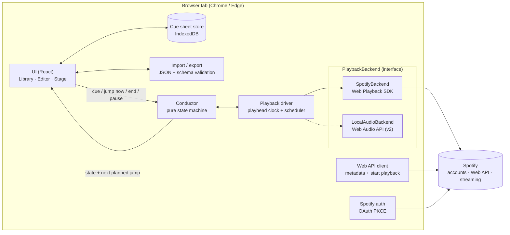
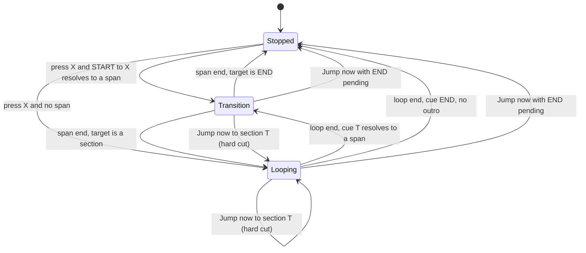
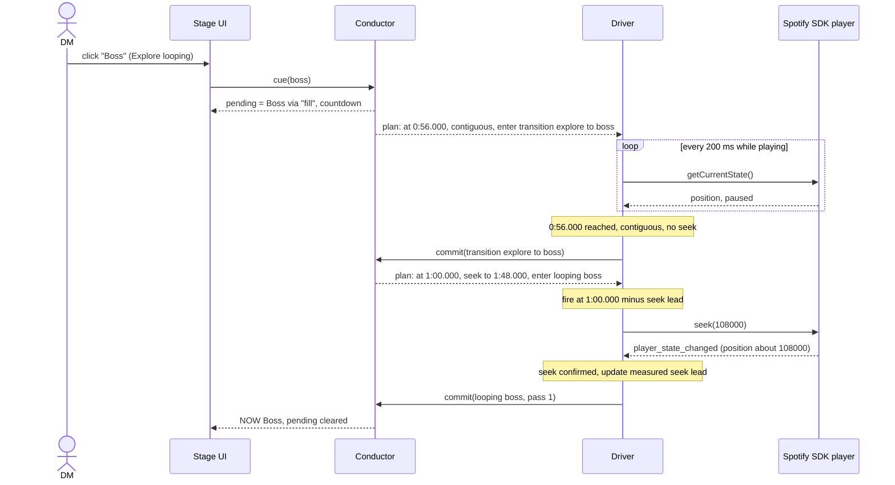

# DM Audio Looper: Technical Design Document

| | |
|---|---|
| **Status** | Draft v0.1, for review |
| **Date** | 2026-11-02 |
| **Scope** | v1 (Spotify playback, local speakers), plus the path to v2 (local audio files) |

---

## 1. Summary

DM Audio Looper is a browser app that lets a tabletop Game Master play a video-game soundtrack the way a game engine does. You split a track into named **sections** (for example *Explore*, *Combat* and *Boss*). The active section loops until you click another one. The switch then happens at the end of the current loop, optionally through a short **transition** taken from the same song.

v1 plays music through **Spotify**, with the browser tab acting as the Spotify playback device. The core logic is kept separate from the audio source, so a **local audio file** backend can be added later. That backend will give seamless, sample-accurate loops, which Spotify cannot.

The main risks are about Spotify, not engineering. Every loop is a seek, so it will never be seamless. Spotify no longer gives apps beat or bar data. Spotify's developer terms restrict apps that alter or remix content, so this tool must remain a personal, unpublished app. See §13.

---

## 2. Background and problem

Video-game music is composed for **adaptive playback**. A game engine loops sections indefinitely and moves between them when gameplay changes (exploration → combat → victory). Official soundtrack releases on streaming services are mixed as **linear songs**: each loop plays once or twice, then the track moves on or fades out.

When a DM plays these tracks during an encounter, the music runs out of the right section or moves into the wrong mood at the wrong time. The DM needs to act as the game engine: decide which section plays, keep it looping, and change it when the story changes.

---

## 3. Requirements captured

### 3.1 Your answers during requirements gathering

| Topic | Your answer | Design consequence |
|---|---|---|
| Audio source | Spotify first; local files as a follow-up | Pluggable `PlaybackBackend` (§6). Spotify backend in v1, local backend in v2 (§14) |
| Platform | Web app | Single-page app with static hosting and no backend (§9.1) |
| How players hear it | Local speakers for v1. Spotify Jam is used today but deferred | The browser tab is the Spotify device. Jam and remote play are out of scope (§13, §14.3) |
| Transition timing | Wait for a musical boundary… | …where the boundary is **the end of the current loop** (no tempo grid) |
| Controls | On-screen buttons | One section pad per section, plus *End*, *Jump now* and *Pause* (§11.3) |
| What a cue can do | Sections within one track; flesh this out in detail | The music model is the core of this doc (§7, §8) |
| Section types | Loop | Every section is a loop. Intros, bridges and outros are modelled as **transitions** (§7) |
| Cueing | One pending cue, plus optional transition audio between sections | Single pending-cue rule (§8.2); transition rules (§7.3) |
| Transitions tied to | Both: a default per destination, overridable per From → To pair | Resolution order: pair rule → destination default → direct (§7.4) |
| Transition audio source | Same track | Transitions are time ranges from the same song (§7.2) |
| Start and stop | Intro lead-in; cued ending | `START` and `END` pseudo-sections, so the intro and outro reuse the transition model (§7.3) |
| Override | Jump now (hard cut) | *Jump now* runs the pending cue immediately (§8.4) |
| Jump now with a transition defined | Skip the transition | A hard cut goes straight to the target loop's start |
| Authoring | Typed timestamps; JSON import/export | A typed-timestamp editor with "preview seam" buttons, and JSON files (§10, §11.2) |

### 3.2 Goals

- **G1.** Define sections (loops) and transitions for a Spotify track using typed timestamps, and save them as a **cue sheet**.
- **G2.** During a session, loop the active section indefinitely and switch to the next section at the end of the current loop.
- **G3.** Play authored transition audio (intro, bridge, fill, outro) between sections when one is defined.
- **G4.** Provide an immediate override (*Jump now*) for dramatic moments.
- **G5.** Keep the core engine independent of the audio source, so local files can replace Spotify without a rewrite.

### 3.3 Non-goals (v1)

- Seamless (gapless) loops on Spotify. This is not achievable (§13).
- Crossfades, layering or mixing two audio streams. Spotify's policy forbids it, and it is not needed for v1.
- Beat- or bar-quantized switching, or tempo grids.
- Switching between tracks inside one cue, playlists, and encounter presets.
- Spotify Jam, Discord, VTT integration, or any remote players.
- Keyboard hotkeys, MIDI, Stream Deck, or a phone remote. The architecture leaves room for these.
- Public distribution or multi-user hosting.

### 3.4 Functional requirements

| ID | Requirement | Priority |
|---|---|---|
| FR-1 | Sign in with Spotify (Premium) and register the tab as a playback device | Must |
| FR-2 | Create a cue sheet from a pasted Spotify track link or URI. Fetch the title, artists, duration and ISRC | Must |
| FR-3 | Add, rename, reorder and delete sections. Each has a loop start and end typed as `m:ss.mmm` | Must |
| FR-4 | Define transitions: a destination default (`* → X`), pair overrides (`A → X`), an intro (`START → X`) and an outro (`* → END`) | Must |
| FR-5 | Validate a cue sheet (ranges, ordering, minimum lengths, duplicate rules) and show clear errors | Must |
| FR-6 | Preview a loop seam or transition: play a few seconds before and after the jump | Must |
| FR-7 | Stage view: click a section to start it (from silence) or queue it (while playing) | Must |
| FR-8 | At the end of each loop pass, run the pending cue (through its transition) or loop again | Must |
| FR-9 | *Jump now*: run the pending cue immediately with a hard cut. If the pending cue is *End*, stop immediately | Must |
| FR-10 | *End*: queue the outro, which plays after the current loop finishes before playback stops | Must |
| FR-11 | Show the current section, loop pass count, position within the loop, pending cue, and time until the switch | Must |
| FR-12 | Persist cue sheets locally. Import and export a single sheet or the whole library as JSON | Must |
| FR-13 | Pause and resume, keeping the current state | Should |
| FR-14 | Seek-timing calibration: a global offset slider plus automatic measurement | Should |
| FR-15 | Always-on-top mini Stage window using Document Picture-in-Picture (Chrome/Edge) | Could |
| FR-16 | "Set from playhead" button and ±10/±100 ms nudge buttons in the editor | Could |

### 3.5 Non-functional requirements

| ID | Requirement | Target |
|---|---|---|
| NFR-1 | **Scheduling accuracy:** the app sends each seek command within ±10 ms of its planned time. This excludes Spotify's own seek time | Logged per jump |
| NFR-2 | **Audible seam:** the gap or stutter at a Spotify loop jump | Median ≤ 150 ms, p95 ≤ 300 ms. **Provisional:** validated in Spike 0 (§16); not fully within our control |
| NFR-3 | **Responsiveness:** a click shows as *pending* in the UI within 50 ms. *Jump now* sends its seek within 50 ms | — |
| NFR-4 | **Session reliability:** over a 4-hour session, no loop overruns its end by more than 500 ms without automatic recovery | Watchdog (§9.6) |
| NFR-5 | **Hosting:** static files only, with no server-side code or secrets | — |
| NFR-6 | **Browsers:** the current desktop Chrome and Edge. Firefox is best-effort. Mobile and Safari are out of scope for v1 | — |
| NFR-7 | **Portability:** every piece of user data can be exported as a human-readable JSON file | — |

---

## 4. Glossary

| Term | Meaning |
|---|---|
| **Cue sheet** | All the loop and transition data for one track |
| **Track time** | A position in the song's own timeline, in integer milliseconds from 0:00.000 |
| **Span** | A half-open range of track time, `[startMs, endMs)` |
| **Section** | A named span that **loops** until a different cue runs. It appears as one pad on the Stage |
| **Transition** | A span played **once** while moving between two nodes, such as a fill, bridge, intro or outro |
| **`START` / `END`** | Pseudo-sections meaning "silence before playback" and "silence after playback". An intro is a transition from `START`, and an outro is a transition to `END` |
| **Cue** | Your request to move to a section, or to `END` |
| **Pending cue** | The cue that will run at the next boundary. There is at most one |
| **Boundary** | The end of the span currently playing (a loop pass or a transition) |
| **Seek** | Moving the playhead to a different track time. On Spotify it causes a short audible gap |
| **Contiguous** | The next span starts exactly where the current one ends, so playback simply continues with no seek |
| **Seek lead** | How early (in ms) a seek is sent so that the new audio arrives on time |

---

## 5. Spotify platform constraints

These were checked against public sources in November 2026; links are in §18. Spotify has changed these rules three times since late 2024, so treat them as **volatile**.

| Constraint | Effect on this design |
|---|---|
| The **Web Playback SDK** turns a browser tab into a Spotify Connect device. It needs Spotify **Premium** and a browser with DRM (Widevine) support | It is the v1 playback engine. Desktop wrappers (Electron or Tauri) cannot host it easily, which is why this is a web app |
| **Audio Analysis and Audio Features endpoints** (beats, bars, sections, tempo) have been closed to new apps since **27 Nov 2024** (they return 403) | No automatic beat grid or section detection. All loop points come from you |
| **Spotify audio is DRM-protected.** Apps cannot read the decoded audio | No waveform display, no analysis and no zero-crossing snapping for Spotify tracks. Loop points are set by ear |
| The **Developer Policy, Section III.7**, says: *"Do not permit any device or system to segue, mix, re-mix, or overlap any Spotify Content with any other audio content (including other Spotify Content)."* | No crossfades and no overlapping audio. Every transition is a jump within one audio stream |
| Spotify's SDK documentation says the platform *"can not be used to develop applications that alter Spotify Content"*. Community moderators have said that skipping sections of a track falls under this | **Policy risk:** looping by seeking may count as altering content. The tool must stay personal and unpublished (§13, risk R1) |
| **Development Mode** (since Feb–Mar 2026): the app owner must have Premium, at most **5 allowlisted users**, and a shared API quota per developer account. HTTP 429 responses carry a `QUOTA_EXCEEDED` reason | Fine for one DM. It rules out publishing the app. API calls are kept to a minimum (§9.2) |
| **OAuth** (enforced since 27 Nov 2025): the implicit grant has been removed, public clients must use **Authorization Code with PKCE**, and redirect URIs must be HTTPS. `localhost` is not allowed; use `http://127.0.0.1:PORT` for local development | A backend-free login with PKCE (§9.1) |
| A Premium account streams to **one device at a time** | While the looper plays, your phone or desktop Spotify app cannot play anything else on the same account |
| There is **no Web API access to Spotify Jam** | Jam cannot be part of v1 (§14.3) |

---

## 6. Architecture overview



| Component | Responsibility | Depends on |
|---|---|---|
| **Conductor** | Holds the musical state (what is playing and what is pending), applies the cueing rules, and computes the **next planned jump**. It has no timers, I/O or framework code, so it can be fully unit-tested | Cue sheet only |
| **Playback driver** | Estimates the playhead, schedules each planned jump at the right moment (sent early by the seek lead), tells the conductor once a jump has happened, and runs the watchdog | Conductor, PlaybackBackend |
| **PlaybackBackend** | A thin wrapper over the audio source: `load`, `play`, `pause`, `seek` and position samples. Each backend declares what it can do (for example, whether it can schedule jumps sample-accurately) | Spotify SDK, or Web Audio |
| **Cue sheet store** | Saves and loads cue sheets in IndexedDB | — |
| **Import/export** | Converts between JSON files and cue sheets, checks them against the schema, and migrates old schema versions | — |
| **UI** | The Library, Editor and Stage views (§11) | All of the above |

**Why the Conductor is separate from the driver:** what should happen next is a deterministic music decision, while getting the audio there on time is a messy, platform-specific timing job. Keeping them apart means:

1. The cueing rules can be tested exhaustively with a fake clock.
2. The local-audio backend in v2 can use the same Conductor unchanged, with its own driver that schedules sample-accurately.

---

## 7. Music model

This section describes the core idea of the app.

### 7.1 Concepts

A cue sheet describes **one track** as a small graph:

- **Nodes** are the track's **sections** (each one is a loop), plus two pseudo-nodes, `START` (silence before) and `END` (silence after).
- **Edges** are optional **transitions**. A transition is a span of the same track that plays once while moving from one node to another.

```
START ──(intro)──► [Explore] ◄──────────────► [Combat] ◄────► [Boss] ──(outro)──► END
                     ⟲ loops                    ⟲ loops          ⟲ loops
```

All positions are **integer milliseconds of track time**. Spans are half-open, `[start, end)`.

### 7.2 Sections (loops)

A section is a named span with a display color. When the playhead reaches `loop.endMs` and nothing is pending, the playhead jumps back to `loop.startMs` and the pass counter goes up by one.

- Sections may overlap or nest. For example, a "Combat (short)" loop can sit inside "Combat (full)".
- Sections can come in any order. Their order in the cue sheet is the order of the pads on the Stage.

### 7.3 Transitions, intros and outros

All transition rules share one shape:

```ts
interface TransitionRule {
  from: SectionId | "@start" | "*";   // "*" means from anywhere, including START
  to:   SectionId | "@end";
  span: Span | null;                  // null means jump directly; it blocks a default
}
```

| What you want | Rule |
|---|---|
| A default lead-in whenever you move into *Combat* | `{ from: "*", to: "combat", span: <fill> }` |
| A different lead-in, only from *Explore* to *Combat* | `{ from: "explore", to: "combat", span: <other fill> }` |
| No lead-in from *Boss* to *Combat*, even though a default exists | `{ from: "boss", to: "combat", span: null }` |
| The song's intro when starting *Explore* from silence | `{ from: "@start", to: "explore", span: <intro> }` |
| An outro after any section when you press *End* | `{ from: "*", to: "@end", span: <outro> }` |
| A different outro after *Boss* | `{ from: "boss", to: "@end", span: <boss ending> }` |

The intro and outro are not special cases. They are transitions to and from the pseudo-nodes, so the engine has one code path.

### 7.4 Transition resolution

When a cue to `T` runs while node `F` is current:

1. If a rule exists with `from = F` and `to = T`, use its span. A `null` span means jump directly.
2. Otherwise, if a rule exists with `from = "*"` and `to = T`, use its span.
3. Otherwise, jump directly to `T`.

When starting from silence, `F` is `"@start"`. Because `"*"` includes `START`, a section's default lead-in also plays when you start that section from silence. To start without it, add a `@start → X` rule with `span: null`.

### 7.5 Contiguity: avoiding seeks

Each Spotify seek leaves an audible gap, so the engine **only seeks when the audio is not continuous**. If the next span starts within `CONTIGUITY_TOLERANCE_MS` (default 20 ms) of where the current span ends, playback simply continues: the conductor changes state and no seek is sent.

Soundtrack releases usually keep the game's sections in their original order, so many moves need no seek at all. The intro flows into the first loop, and a natural bridge flows into the next loop. Only the loop-back itself (end → start) always needs a seek.

### 7.6 Worked example

The track is a fictional *"Example Battle Theme"*, 2:45.000 long:

```
0:00.000  0:08.000                         0:56.000 1:00.000                         1:48.000                         2:36.000  2:45.000
   |-intro-|=========== Explore ============|-fill-|============ Combat ============|============= Boss =============|-outro-|
```

| Rules | |
|---|---|
| `@start → explore` | `0:00.000–0:08.000` (intro) |
| `* → combat` | `0:56.000–1:00.000` (fill, the default lead-in) |
| `explore → boss` | `0:56.000–1:00.000` (the same fill, reused for *Boss*) |
| `* → @end` | `2:36.000–2:45.000` (outro) |

| Move | What plays | Seeks |
|---|---|---|
| Start *Explore* | intro → Explore. Contiguous, so it flows | **0** |
| *Explore* loops | at 0:56 → 0:08 | 1 per pass |
| *Explore* → *Combat* | Explore end (0:56) → fill flows → fill end (1:00) flows into Combat | **0** |
| *Combat* → *Explore* | no rule → at 1:48, jump to 0:08 | 1 |
| *Explore* → *Boss* | Explore end flows into the fill → at 1:00, jump to 1:48 | 1 |
| *Boss* → *End* | Boss end (2:36) flows into the outro → stop at 2:45 | **0** |
| *Explore* → *End* | at 0:56, jump to 2:36 → outro → stop | 1 |
| *Combat* → *Boss* with *Jump now* | immediate jump to 1:48 | 1 |

---

## 8. Playback rules (Conductor)

### 8.1 States



The Conductor's state is a single record:

```ts
type PlayState =
  | { kind: "stopped" }
  | { kind: "looping"; section: SectionId; pass: number }
  | { kind: "transition"; from: SectionId | "@start"; to: SectionId | "@end"; span: Span };

interface ConductorState {
  play: PlayState;
  pending: SectionId | "@end" | null;
  paused: boolean;            // pausing freezes whatever play state is current
}
```

### 8.2 Cue rules (clicking a section pad or *End*)

| Current state | You click | Result |
|---|---|---|
| Stopped | section X | **Starts immediately.** Resolve `@start → X`: play the intro span if there is one, otherwise X's loop |
| Stopped | *End* | Nothing (button disabled) |
| Looping S, nothing pending | section X ≠ S | `pending = X` |
| Looping S, nothing pending | S itself | Nothing |
| Looping S, pending P | P again | **Cancel:** `pending = null` |
| Looping S, pending P | S (the current section) | **Cancel**, meaning "stay here" |
| Looping S, pending P | another section X | **Replace:** `pending = X` |
| Looping S | *End* | `pending = @end`. Clicking *End* again cancels it |
| Transition F → T | section X ≠ T | `pending = X`. It runs at the **next** boundary, after T's first loop pass (§8.3) |
| Transition F → T | T | Nothing |
| Transition F → @end (outro playing) | section X | `pending = X`. When the outro ends, X starts as if from silence (`@start → X`) |

The time until the switch is always visible as a countdown on the pending pad (§11.3).

### 8.3 Boundaries

A **boundary** is the end of the span currently playing.

- **End of a loop pass in section S:**
  - If something is pending, resolve the transition `S → pending` (§7.4). Play the transition span if there is one, otherwise enter the target loop (or stop, if the target is `END`). Then clear the pending cue.
  - If nothing is pending, loop again: seek to `S.loop.startMs` and add one to the pass count.
- **End of a transition span:** enter the target loop at `loop.startMs`, or stop if the target is `END`.

Every move into a new span is a seek, unless the spans are contiguous (§7.5).

**Decision (D11): transitions run to completion once they start.** A transition was written to lead into a specific target, so cutting it short would usually sound wrong. A cue made during a transition waits for the next boundary. *Jump now* can still interrupt.

### 8.4 *Jump now* (hard cut)

*Jump now* runs the **pending** cue immediately. The button is disabled when nothing is pending, so a hard cut takes two clicks: the destination pad, then *Jump now*.

- **Pending section T:** seek straight to `T.loop.startMs` and **skip any transition**, as you chose. The state becomes `looping T`, pass 1.
- **Pending `END`:** pause immediately and go to `stopped`. This doubles as the "stop now" button.

A possible later improvement is a one-click shortcut, such as Shift+click or a long-press on a pad.

### 8.5 Pause and resume

*Pause* (FR-13) pauses the backend and freezes the Conductor's state, including the pending cue. *Resume* continues from the same position, and the driver plans the next jump again from the new clock samples.

### 8.6 What the Conductor gives the driver

After every event, the Conductor reports the **next planned jump**:

```ts
interface PlannedJump {
  atMs: TrackMs;            // the boundary: the end of the current span
  seekToMs: TrackMs | null; // null means contiguous: just change state, no seek
  stopAfter: boolean;       // true when the next state is "stopped"
  next: PlayState;          // the state once the jump is done
}
```

The driver carries out the plan and calls `conductor.commit(plan)` once it has happened. The Conductor never deals with wall-clock time.

---

## 9. Spotify backend (v1)

### 9.1 Login and device setup

1. The user clicks **Connect Spotify**, which starts the **Authorization Code with PKCE** flow in the browser. No client secret and no backend are needed.
   - **Scopes:** `streaming user-read-email user-read-private` (needed by the SDK), plus `user-modify-playback-state user-read-playback-state`.
   - **Redirect URIs:** `https://<you>.github.io/<repo>/callback` (production) and `http://127.0.0.1:5173/callback` (development; `localhost` is not allowed).
   - **Tokens:** the access token is kept in memory only. The refresh token is kept in IndexedDB so you stay signed in, and it is refreshed automatically before it expires.
2. Load `https://sdk.scdn.co/spotify-player.js` and create a `Spotify.Player` named **"DM Audio Looper"**.
3. Inside the same click handler, call `player.activateElement()`, because browsers only allow audio to start after a user gesture.
4. On the `ready` event, record the `device_id`.
5. Check `GET /v1/me` for `product === "premium"` and show a clear error if the account isn't Premium.

### 9.2 Spotify calls

To save API quota and avoid network delay, **all time-critical commands go through the SDK's local player**, not the Web API.

| Purpose | Call | When |
|---|---|---|
| Track metadata | `GET /v1/tracks/{id}` (name, artists, `duration_ms`, `external_ids.isrc`) | When a cue sheet is created |
| Load a track on our device | `PUT /v1/me/player/play?device_id=…` with body `{ "uris": [trackUri], "position_ms": startMs }` | When the Stage opens a sheet (preload) and when playback starts |
| Safety net against track end | `PUT /v1/me/player/repeat?state=track&device_id=…` | After loading |
| Seek, pause, resume, volume | SDK: `player.seek(ms)`, `pause()`, `resume()`, `setVolume()` | Every boundary. **No Web API calls** |
| Playhead samples | SDK: the `player_state_changed` event and `getCurrentState()` | Continuously |
| Search (optional) | `GET /v1/search?type=track` (may be capped at 10 results in Development Mode) | In the editor |

A typical session makes **only a few dozen Web API calls**, all at start-up and when loading tracks.

**Preload:** starting a track is a network round trip of several hundred milliseconds. When a sheet opens on the Stage, the backend loads the track at its first section's start **with volume at 0**, pauses, and then restores the volume. The first click then only needs a local `resume()`.

### 9.3 Playhead clock

The SDK gives position samples but not a continuously running clock. The driver keeps an **anchor** and extrapolates from it:

```
sample = { positionMs, perfMs: performance.now() at receipt, paused }
estimate(t) = paused ? sample.positionMs : sample.positionMs + (t − sample.perfMs)
```

- **Sample sources:** every `player_state_changed` event, plus a `getCurrentState()` poll every 200 ms while playing (configurable).
- **Jitter control:** a new sample replaces the anchor only if it differs from the estimate by more than 15 ms, or if a seek or pause has just happened. This stops small reporting noise from moving planned jumps.
- **Track check:** each sample's track ID is compared with the cue sheet's track, including Spotify's `linked_from` for re-linked regional versions. A mismatch means playback was taken over (§9.6).

### 9.4 Scheduling a jump

For each `PlannedJump`:

```
fireAt (wall clock) = now + (plan.atMs − estimate(now)) − seekLeadMs     // only if plan.seekToMs is not null
```

- **Two-stage timer:** a coarse `setTimeout` wakes the driver about 50 ms before `fireAt`. A short fine loop (a `MessageChannel` tick about every 4 ms) then sends `player.seek()` at `fireAt`. When playback is contiguous, the state simply changes at `atMs` with no seek.
- **Background tabs:** Chrome exempts **audible** tabs from background timer throttling, and while the looper is playing the tab is audible. A Web Worker timer is kept as a fallback in case browser behavior changes.
- **Replanning:** the jump is planned again whenever the pending cue changes, the anchor moves by more than 10 ms, or playback pauses or resumes.
- **Late:** if `fireAt` has already passed (for example, the laptop was busy), the seek fires immediately and the delay is logged.

This is the *Explore → Boss* move from §7.6. Explore's end flows into the fill with no seek, and one seek happens at the end of the fill:



### 9.5 Seek-lead compensation

`player.seek()` returns before the new audio is audible. The jump would land late unless it is sent early by the expected delay.

- **Measured part:** a moving average of the time from calling `seek()` to the first state sample within ±50 ms of the target. It is limited to the range 0–400 ms.
- **User offset:** a global ±300 ms slider in Settings, tuned by ear with the editor's *Preview seam* button. Speaker latency (for example, Bluetooth) delays the old and new audio equally, so it does **not** need compensation.
- **Effective lead** = measured part + user offset.
- **Trade-off:** sending early cuts the last few milliseconds of the loop instead of making the loop start late, which keeps the next loop on the beat. Spike 0 (§16) checks whether the measured part actually matches what you hear.

**Authoring tip (for the editor's help text):** loops sound best when the end point sits on a sustained note or a beat where a short gap is hard to notice.

### 9.6 Failures and recovery

| Situation | Detection | Response |
|---|---|---|
| A boundary is missed (the playhead passes `atMs` + 300 ms with no jump in progress) | Watchdog | Seek immediately to where playback should be, log it, and briefly show a warning |
| A seek does not land (no matching sample within 1 s) | Seek confirmation | Retry once, then fall back to *stopped* with an error banner |
| The track plays to its end | A position jump to about 0, or the track changes | Repeat-track brings the track back. The Conductor moves to the correct span start |
| Playback is taken over (you played something on your phone) | A different track, or the device is no longer active | Move to *stopped* and show "Playback moved to another device. Reconnect?" |
| Token expired | A 401 response | Refresh silently. If that fails, ask the user to sign in again |
| Quota or rate limit | A 429 response (`QUOTA_EXCEEDED` or rate limit) | Back off, and tell the user that only metadata and loading are affected while the current track keeps looping |
| Network drops | SDK errors or no samples | Spotify buffers ahead, so the current loop may keep working for a while. Show an "offline" badge and retry |
| The laptop sleeps | — | While the Stage is open, request a **Screen Wake Lock** |

---

## 10. Data model and persistence

### 10.1 Types

```ts
type TrackMs = number;                    // integer milliseconds of track time
interface Span { startMs: TrackMs; endMs: TrackMs }   // [start, end)

interface CueSheet {
  schema: "dmaudiolooper/cuesheet";
  schemaVersion: 1;
  id: string;                             // UUID
  title: string;                          // display name, which you can edit
  source: SpotifySource;                  // v2 adds LocalSource
  sections: Section[];                    // order = pad order on the Stage
  transitions: TransitionRule[];
  notes?: string;
  createdAt: string;                      // ISO 8601
  updatedAt: string;
}

interface SpotifySource {
  kind: "spotify";
  trackUri: string;                       // spotify:track:<id>
  trackName: string;
  artists: string[];
  durationMs: TrackMs;
  isrc?: string;                          // lets v2 match the same recording as a local file
}

interface Section {
  id: string;                             // short ID, stable across renames
  name: string;
  color?: string;
  loop: Span;
}

interface TransitionRule {
  from: string | "@start" | "*";
  to: string | "@end";
  span: Span | null;
  label?: string;                         // e.g. "drum fill"
}
```

### 10.2 Example file

This is the worked example from §7.6:

```json
{
  "schema": "dmaudiolooper/cuesheet",
  "schemaVersion": 1,
  "id": "7f1c2a9e-3b4d-4e8f-9a01-2c3d4e5f6a7b",
  "title": "Example Battle Theme",
  "source": {
    "kind": "spotify",
    "trackUri": "spotify:track:0000000000000000000000",
    "trackName": "Example Battle Theme",
    "artists": ["Example Composer"],
    "durationMs": 165000
  },
  "sections": [
    { "id": "explore", "name": "Explore", "color": "#4f8a5b", "loop": { "startMs": 8000,   "endMs": 56000 } },
    { "id": "combat",  "name": "Combat",  "color": "#b5452f", "loop": { "startMs": 60000,  "endMs": 108000 } },
    { "id": "boss",    "name": "Boss",    "color": "#6b3fa0", "loop": { "startMs": 108000, "endMs": 156000 } }
  ],
  "transitions": [
    { "from": "@start",  "to": "explore", "span": { "startMs": 0,      "endMs": 8000 },   "label": "intro" },
    { "from": "*",       "to": "combat",  "span": { "startMs": 56000,  "endMs": 60000 },  "label": "fill" },
    { "from": "explore", "to": "boss",    "span": { "startMs": 56000,  "endMs": 60000 },  "label": "fill" },
    { "from": "*",       "to": "@end",    "span": { "startMs": 156000, "endMs": 165000 }, "label": "outro" }
  ],
  "createdAt": "2026-11-02T18:00:00Z",
  "updatedAt": "2026-11-02T18:00:00Z"
}
```

A library export wraps these as `{ "schema": "dmaudiolooper/library", "schemaVersion": 1, "cueSheets": [ ... ] }`.

### 10.3 Validation

Errors block saving to the Stage. Warnings are shown but allowed.

| Check | Severity |
|---|---|
| A span is not `0 ≤ startMs < endMs ≤ durationMs` | Error |
| A section loop is shorter than 1 s | Error |
| A section loop is shorter than 5 s (seek gaps become very noticeable) | Warning |
| A transition span is shorter than 250 ms | Error |
| A loop ends within 250 ms of the track's end (risk of the track ending before the seek) | Warning |
| `from` or `to` refers to a section that doesn't exist; `@end` used as `from`; `@start` used as `to` | Error |
| Two rules have the same `(from, to)` | Error |
| A rule has `from == to` and is not `*` | Error |
| Two sections share a name | Warning |
| Loops overlap | Allowed (no message) |

### 10.4 Storage and import/export

- **Storage:** IndexedDB, through the small `idb` wrapper. It holds the cue sheets, settings (seek offset, poll interval) and the refresh token. IndexedDB is chosen over `localStorage` because v2 needs to store file handles for local audio, which `localStorage` cannot hold.
- **Export:** one sheet or the whole library, as `.json` files.
- **Import:** checked against the schema with `zod`. Older `schemaVersion`s are upgraded by migration functions. When a sheet with the same `id` already exists, the user chooses **keep both**, **replace**, or **skip**.
- **Sharing with other DMs:** JSON files contain only timestamps and track IDs, never audio, so they can be shared freely. The recipient needs Premium and access to the same track.
- **No cloud sync** in v1. To move between devices, export and import.

---

## 11. User interface

There are three views. The UI is built for a laptop screen and mouse use at the table.

### 11.1 Library

A list of cue sheets with search, **New from Spotify link**, **Import**, and **Export all**. Clicking a sheet opens it on the Stage. An edit icon opens the Editor.

### 11.2 Editor

```
┌ Example Battle Theme · Example Composer · 2:45.000 ─────────────────────────────┐
│ SECTIONS                                                                         │
│  ≡  Name      Loop start   Loop end    Length   Preview                          │
│  ≡  Explore   0:08.000     0:56.000    48.0 s   [▶ seam]                         │
│  ≡  Combat    1:00.000     1:48.000    48.0 s   [▶ seam]                         │
│  ≡  Boss      1:48.000     2:36.000    48.0 s   [▶ seam]       [+ Add section]   │
│                                                                                  │
│ TRANSITIONS                                                                      │
│  From      To        Span                     Label      Preview                 │
│  Start     Explore   0:00.000 – 0:08.000      intro      [▶]                     │
│  Any       Combat    0:56.000 – 1:00.000      fill       [▶]                     │
│  Explore   Boss      0:56.000 – 1:00.000      fill       [▶]                     │
│  Any       End       2:36.000 – 2:45.000      outro      [▶]  [+ Add transition] │
│                                                                                  │
│ ⚠ Boss → Combat uses the default "fill" (no override)               [Validate]   │
└──────────────────────────────────────────────────────────────────────────────────┘
```

- **Timestamp fields** accept `m:ss.mmm`, `ss.mmm` or raw milliseconds, and paste-friendly forms such as `1:12.4`. The ↑/↓ keys nudge by 10 ms, and Shift+↑/↓ by 100 ms (FR-16).
- **▶ seam** plays the last 4 s of the loop, jumps to the loop start the same way it will on the Stage, then plays 4 s more. This is how you check typed timestamps by ear.
- **▶ (transition)** plays the last 3 s of the *from* loop, then the transition, then 3 s of the *to* loop, following the real rules.
- **Transition matrix (optional):** a From × To grid that shows the resolved transition for every pair, so gaps and surprises are easy to spot.

### 11.3 Stage (used during play)

```
┌ ♪ Example Battle Theme ─────────────────────────────────── [Library] [Edit] ┐
│ NOW   Explore · pass 3 · 0:41 / 0:48   ▓▓▓▓▓▓▓▓▓▓▓▓▓▓▓▓▓▓▓▓░░░░░            │
│ NEXT  Combat via "fill" · in 0:07                         [ ⚡ Jump now ]   │
├─────────────────────────────────────────────────────────────────────────────┤
│  ┌─────────────┐   ┌─────────────┐   ┌─────────────┐                        │
│  │  Explore    │   │  Combat     │   │  Boss       │                        │
│  │  ▶ playing  │   │  ◷ 0:07     │   │             │                        │
│  └─────────────┘   └─────────────┘   └─────────────┘                        │
│  [ ■ End (outro) ]                                         [ ❚❚ Pause ]      │
└─────────────────────────────────────────────────────────────────────────────┘
```

- **Pads** are large, colored buttons. The playing pad shows a progress bar. The pending pad pulses and counts down to the switch.
- ***Jump now*** is enabled only while a cue is pending. Its label reflects the pending cue, for example "Jump to Combat" or "Stop now".
- **Mini Stage (FR-15):** a compact version of the pads in an always-on-top **Document Picture-in-Picture** window (Chrome/Edge 116+). It can float over your VTT or notes, which is the "overlay" from your original idea.
- **Debug drawer (hidden by default):** shows the seek lead, the last jump's lateness, the sample rate and the anchor drift. It is used in Spike 0 and when tuning.

---

## 12. Key decisions

| ID | Decision | Alternatives considered | Rationale | Decided by |
|---|---|---|---|---|
| D1 | **Web app** (single-page app, static hosting) | Desktop (Electron/Tauri), VTT module, Discord bot | The Spotify Web Playback SDK needs a browser with DRM support. It is the cheapest to build and host, and leads naturally to Web Audio for local files | You |
| D2 | **The browser tab is the Spotify device** (Web Playback SDK) | Remote-controlling the Spotify desktop or phone app through the Connect Web API | Seeks and position samples stay local: no network round trip per loop and no API quota spent per loop. The cost is that the official Spotify apps and Jam aren't used in v1 | Recommended; you agreed |
| D3 | **No backend**; OAuth PKCE in the browser | A small token server | Spotify requires PKCE for public clients. There are no secrets to protect and nothing to host | Proposed |
| D4 | **Conductor kept separate from the driver and backend** | One player class | Deterministic, testable rules; local audio in v2 reuses the Conductor unchanged | Proposed |
| D5 | **Boundary = end of the current span** | Tempo grid; hand-placed exit points | Your choice. It needs no beat data (Spotify no longer provides any) and is the simplest to author. Waiting is limited by *Jump now* | You |
| D6 | **One pending cue**, with replace and cancel | A FIFO queue | Your choice. It fits improvised play and the Stage stays readable | You |
| D7 | **Transitions are same-track spans**, resolved pair → destination default → direct, with `START`/`END` pseudo-nodes | Separate intro and outro fields; transitions only per pair | Your choices. The pseudo-nodes cover intros and outros with one rule type and one code path | You (model shape proposed) |
| D8 | ***Jump now* = immediate hard cut that skips transitions**; with `END` pending it means stop now | Fade then jump; playing the transition immediately | Your choice. Fading isn't allowed to overlap anyway, and this reuses the pending cue so no extra buttons are needed | You |
| D9 | **Seek only when the audio is discontinuous** (contiguity) | Always seek | Each Spotify seek is an audible gap, so many moves can play with no gap | Proposed |
| D10 | **Send seeks early by a measured + user-tuned lead** | Seek exactly at the boundary | Keeps the next loop on the beat. The measurement is checked in Spike 0 | Proposed |
| D11 | **Transitions run to completion**; cues made during one wait for the next boundary | Cut transitions short | A transition is written for its target, so cutting it usually sounds wrong. *Jump now* is still available | Proposed, needs review |
| D12 | **IndexedDB + versioned JSON import/export**; no cloud | localStorage; a cloud database | Portable and private. IndexedDB can also hold v2 file handles | Proposed |
| D13 | **Never overlap, mix, process, record or cache Spotify audio** | Crossfades | Spotify Developer Policy III.7 and the DRM | Required |
| D14 | **Stack: TypeScript, React and Vite; Vitest; Playwright**; `idb`; `zod` | Svelte; plain JavaScript | Widely used and well-typed. The Conductor is plain TypeScript and doesn't depend on any framework | Proposed |
| D15 | **Positions in integer milliseconds of track time** | Seconds as floating point; samples | Easy to read in JSON and editors, with no floating-point drift. v2 converts to samples internally | Proposed |

---

## 13. Limitations and risks

| ID | Limitation or risk | Impact | Likelihood | Mitigation |
|---|---|---|---|---|
| **R1** | **Spotify policy:** looping or skipping parts of a track may count as "altering Spotify Content", even with no overlap or mixing. Spotify could disable the app's client ID. *(This is a reading of public terms, not legal advice.)* | High: the Spotify path stops working | Medium | Keep the app personal and unpublished (one allowlisted user, no public hosting for others). Never overlap or process audio (D13). **The local-file backend is the long-term hedge**, and the architecture keeps it cheap (§14) |
| R2 | **Loops are not seamless on Spotify.** Every non-contiguous jump has an audible gap or stutter, and its length isn't under our control | Medium: less immersive than in-game | Certain | Seek lead (D10), contiguity (D9), authoring tips, and Spike 0's go/no-go (§16). Local files fix this |
| R3 | **No beat grid or waveform:** Audio Analysis is closed and the audio is DRM-protected, so loop points are found by ear | Authoring takes longer | Certain | Typed timestamps, *Preview seam*, nudge controls, and shareable JSON (pull timestamps from wikis or other DMs). Waveforms arrive with local files |
| R4 | **Waiting for the end of the loop** can take as long as one full loop pass (minutes for long loops) | Slow reactions | Certain | *Jump now*. Authors can define shorter sub-loops (overlapping sections are allowed). Beat-level boundaries are planned for v2 |
| R5 | **Development Mode limits:** Premium owner, 5 users, shared quota. The rules changed three times between 2024 and 2026 | Medium: future changes could break the app | Medium | Minimal Web API use (§9.2), and the backend sits behind an interface |
| R6 | **One stream per account:** you can't use Spotify elsewhere while the looper plays, and opening Spotify on another device takes over playback | Low | Medium | Take-over detection and a reconnect prompt (§9.6) |
| R7 | **Re-linked or remastered tracks:** the same song can have different track IDs or slightly different timing by region or edition | Loop points drift | Low | Store the track URI and ISRC. Accept `linked_from` matches. Warn if the reported duration differs from the stored one by more than 500 ms |
| R8 | **Browser dependence:** desktop Chrome/Edge only, the tab must stay open, and the first playback needs a click | Low | — | `activateElement()` on Connect, a wake lock, and a warning when the tab closes |
| R9 | **Needs internet at the table** | Medium if the venue's Wi-Fi is poor | Low–Medium | Spotify buffers ahead, so the current track keeps looping during short drops. Local files work fully offline |
| R10 | **No Jam or remote players in v1** | Online groups and hybrid tables aren't served | Certain | §14.3 describes possible paths |
| R11 | **Scheduling in the browser** (timer delays, garbage-collection pauses) | Occasional late jumps | Low | Two-stage timer, the audible-tab exemption, a Worker fallback, and the watchdog |

---

## 14. Future roadmap

### 14.1 v2: local audio files

The Conductor, the data model and the UI stay the same. Only a new backend and driver are added.

| Area | Approach |
|---|---|
| Playback | **Web Audio API:** decode to an `AudioBuffer` and play spans with `AudioBufferSourceNode.start(when, offset, duration)` on the audio clock, using a look-ahead scheduler (about 100 ms ahead). Seams are **sample-accurate and gapless** |
| Click-free seams | Short 5–10 ms equal-power crossfades at each jump, which is allowed for your own files |
| Driver | `capabilities.sampleAccurate = true`. The driver schedules the planned jump in advance instead of seeking on a timer |
| Files | The File System Access API (handles stored in IndexedDB), with drag-and-drop as a fallback. A 5-minute stereo track uses about 100 MB of decoded memory, which is acceptable on a laptop |
| Authoring | Waveform view, snapping to zero crossings, and import of `LOOPSTART`/`LOOPLENGTH` tags (common in game rips) and WAV `smpl` loop chunks |
| Moving sheets across | `source.kind = "local"` plus an `offsetMs` to line up a Spotify cue sheet with a local file of the same recording (matched by ISRC or title) |
| Musical boundaries | With the audio available, a tempo grid (tap tempo or beat detection) allows switching **on the next bar or phrase** instead of only at the end of the loop |

### 14.2 Later features (in no particular order)

- **More ways to trigger:** keyboard hotkeys, MIDI (Web MIDI), a Stream Deck (through keyboard shortcuts), or a phone remote (WebRTC or a small relay).
- **Multiple tracks:** moving between tracks, and scene or encounter presets (for example, "Goblin ambush" = track X starting at section *Tense*).
- **Desktop wrapper:** for global hotkeys and a real overlay window, once local files make DRM irrelevant.
- **VTT bridge:** a Foundry module that sends combat or scene events to the looper, or that plays local-file loops through Foundry's synced audio.

### 14.3 Remote players and Jam

| Option | Notes |
|---|---|
| Spotify adds a Jam API | Not available today. It would need to be re-evaluated |
| **Follower mode:** each remote player runs the looper with their own Premium login. The DM's Conductor sends its commits over a relay, and each follower seeks locally | Development Mode's 5-user limit fits a DM plus 4 players. All of R1 still applies, and the timing between listeners would only be approximate |
| Local files plus a Discord bot or VTT audio | The cleanest route for online groups. It isn't possible with Spotify audio |

---

## 15. Testing strategy

| Layer | Approach |
|---|---|
| **Conductor** | Unit tests (Vitest) covering every row of §8.2, every resolution case in §7.4, and contiguity. Table-driven tests built on the §7.6 example. Property-based tests (`fast-check`): a random sequence of cues never produces an invalid state, and there is always exactly one planned jump while playing |
| **Driver** | Tests with a **fake clock and a fake backend** that has a configurable seek delay, delay jitter and sample noise. They check that the fire time equals boundary minus lead, that replanning happens on cue changes, and that late jumps, the watchdog and take-over detection work |
| **Validation and import** | Schema tests with good and bad fixtures, plus migration tests |
| **UI end-to-end** | Playwright, with the app running on the fake backend through a `?backend=fake` dev flag. These tests cover creating a sheet, cueing, *Jump now*, *End*, and import/export |
| **Spotify integration** | **Manual only.** DRM and real logins can't run in CI. There's a manual test script plus the Spike 0 measurement page |

---

## 16. Delivery plan

| Milestone | Contents | Exit criteria |
|---|---|---|
| **Spike 0: measure Spotify seeks** (go/no-go) | PKCE login, SDK device, a hard-coded track, and a 10 s loop for 100 passes. Log the seek-to-sample delay. **Record the speaker output** with a phone or external recorder (tab capture can't record DRM audio) and measure the gaps in an audio editor | Median gap and p95 gap compared with NFR-2. **If it fails:** decide with you whether to accept it or bring v2 (local files) forward |
| **M1: Conductor + Stage** | Conductor with tests, the driver, the Spotify backend, and a Stage loading a hand-written JSON sheet | All of §8 works against a real track. NFR-1 and NFR-3 are met |
| **M2: Editor + library** | Editor with validation and previews, IndexedDB storage, import/export | You can author the §7.6 example from scratch in the UI |
| **M3: Hardening** | Calibration settings, all of §9.6, wake lock, mini Stage (Picture-in-Picture), deployment to GitHub Pages | A 4-hour soak test passes NFR-4 |
| **v2** | Local audio backend (§14.1) | Gapless loops with the same cue sheets |

---

## 17. Open questions

1. **Gap tolerance:** what gap at the loop point is acceptable at the table? Spike 0 will give real numbers, and that decides how much effort goes into Spotify versus moving local files forward.
2. **D11 behavior:** is "transitions run to completion" right, or should a new cue during a transition skip straight to the new target when the transition ends?
3. **Clicks during an outro:** is "the outro finishes, then the pending section starts from silence" right, or should clicking a section during an outro cancel the ending?
4. **Hosting:** GitHub Pages (needs an HTTPS redirect URI) or only on `127.0.0.1` on your laptop? This affects only the setup steps.
5. **Sharing:** do you want a public "cue sheet pack" format or repository for other DMs, or is file sharing enough?
6. **Accounts:** will the Spotify developer app be registered under your own Premium account? Development Mode requires that.

---

## 18. References

- Spotify Developer Policy, effective 15 May 2025, Section III.7: <https://developer.spotify.com/policy/>
- Spotify Developer Terms: <https://developer.spotify.com/developer-terms-of-use/>
- February 2026 Development Mode migration guide: <https://developer.spotify.com/documentation/web-api/tutorials/february-2026-migration-guide>
- Web API quota updates for Development Mode (23 Jul 2026): <https://developer.spotify.com/blog/2026-07-23-web-api-quota-updates>
- TechCrunch, "Spotify changes developer mode API to require premium accounts, limits test users" (6 Feb 2026): <https://techcrunch.com/2026/02/06/spotify-changes-developer-mode-api-to-require-premium-accounts-limits-test-users/>
- Increasing the security requirements for integrating with Spotify (12 Feb 2025): <https://developer.spotify.com/blog/2025-02-12-increasing-the-security-requirements-for-integrating-with-spotify>
- OAuth migration reminder (27 Nov 2025): <https://developer.spotify.com/blog/2025-10-14-reminder-oauth-migration-27-nov-2025>
- Redirect URI requirements: <https://developer.spotify.com/documentation/web-api/concepts/redirect_uri>
- Web Playback SDK reference: <https://developer.spotify.com/documentation/web-playback-sdk/reference>
- Web Playback SDK out of beta (13 Sep 2021): <https://developer.spotify.com/blog/2021-09-13-web-playback-sdk-out-of-beta>
- iOS SDK reference (the "alter Spotify Content" restriction): <https://developer.spotify.com/documentation/ios/reference>
- Community thread on audio-features and audio-analysis access for new apps: <https://community.spotify.com/t5/Spotify-for-Developers/Request-to-Enable-Access-to-Audio-Features-and-Audio-Analysis/m-p/7062280/highlight/true>
- Community thread on customizing playback under policy III.7: <https://community.spotify.com/t5/Spotify-for-Developers/Allowing-users-to-customise-audio-playback/m-p/6459860/highlight/true>
- Community idea, "Give the Spotify Web API access to Jams": <https://community.spotify.com/t5/Live-Ideas/Give-the-Spotify-Web-API-Access-to-Jams/idc-p/6367256/highlight/true>
- Chrome background tab throttling (audible tabs are exempt): <https://developer.chrome.com/blog/background_tabs>
